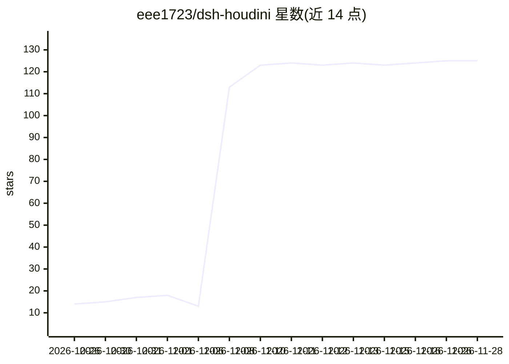

# eee1723/dsh-houdini

⭐ 125 · Python · 推送 2026-11-23 · [GitHub](https://github.com/eee1723/dsh-houdini) · 个人维护 · 中文 README

**DeepSeek Harness 桌面插件：让 AI Agent 用自然语言构建 Houdini 工程**

为 DeepSeek Harness Desktop 提供的插件，新增一个 Houdini 模式，使 AI Agent 能以自然语言创建、检查和维护可继续编辑的 SideFX Houdini 工程，产出节点网络、参数和数字资产而非生成图。覆盖程序化建模、HDA 封装、场景排错诊断、HIP 保存与渲染结果查看。通过 Desktop 插件索引或 npm 包名安装，需配合指定版本的 Desktop 宿主与 Houdini 21.0/22.0 使用。

## 筛选速览

| 维度 | 判定 | 备注 |
|---|---|---|
| AI 角色 | `ai-ecosystem` | LLM/agent 周边工具 |
| 许可风险 | `none` | — |
| 部署形态 | `None` |  |
| 模型依赖 | locked-api |  |
| 硬件要求 | — | 无带数字的原话,不猜 |
| 安装摩擦 | `low` | 无编译、无系统依赖或容器化 |
| 成熟度 | — | 结构信号不足 |

## 能力要点

- 在 Desktop 内以自然语言搭建可编辑的 Houdini 节点网络与参数控制节点
- 支持封装 HDA、保存 HIP、定位网络错误与查看执行回执
- 提供插件索引与 npm 包名两种安装途径，兼容 npmmirror 镜像
- 支持从 Houdini 内 Open Workspace 回到同一对话现场

## 适用场景

- 让 AI 按文字描述搭一套参数化的程序化模型（如螺旋楼梯）
- 在 Houdini 场景里定位错误并查看渲染与任务执行回执
- 整理节点、封装 HDA 后交付 Unreal 使用
- 把文字/视频教程转成可调整的示例工程

## 场景标签

`编码 Agent` `代码生成` · 领域:编码与开发

## 证据(README 行号)

> L5: 在 DeepSeek Harness Desktop 里用自然语言操作真实的 Houdini 工程。得到的是可以继续改的节点网络、参数和数字资产，不是一张生成图。插件增加一个 **Houdini** 模式，不替换 Desktop，也
> L17: **Windows x64 · DSH 0.2.3-alpha.2 / 0.2.2-rc.5 · Houdini 21.0 / 22.0**。先在 Desktop 设置中查看宿主版本：仍使用 rc.3 时选插件 **0.1.12*

## 星数曲线

2026-10-26 14 → 2026-11-28 125（+111）

---
*卡片 v1 · prompt 1.4 · 生成 2026-11-28 · 置信度 high · 依据 README sha `ce74a004da88` · [字段定义](../../DATASET.md)*
