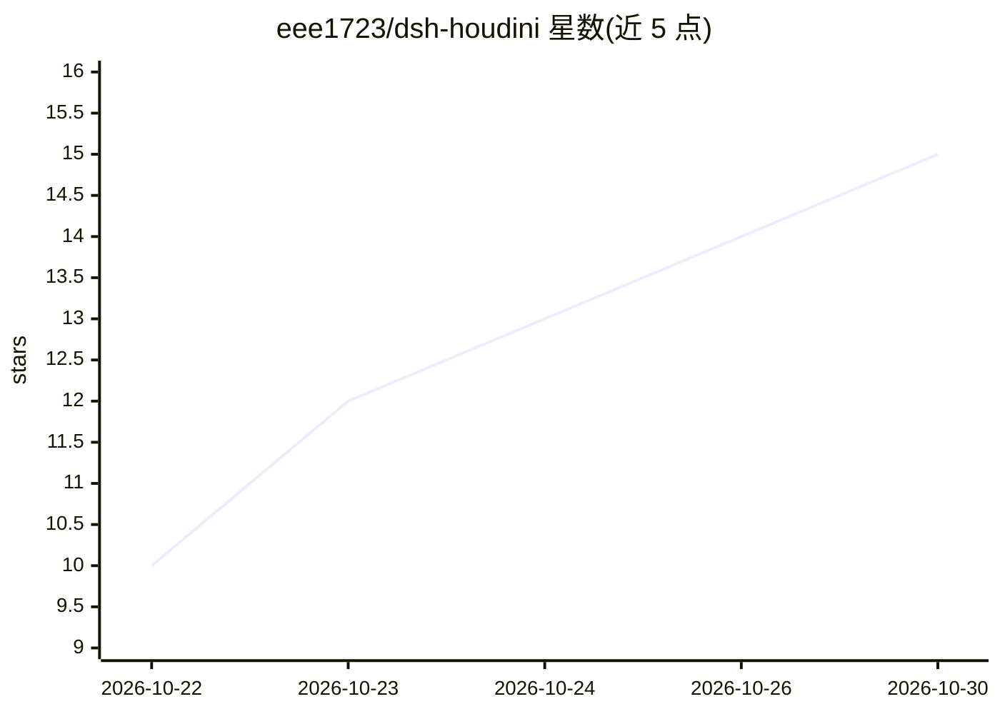

# eee1723/dsh-houdini

⭐ 15 · Python · 推送 2026-10-29 · [GitHub](https://github.com/eee1723/dsh-houdini) · 个人维护 · 中文 README

**让 AI Agent 用自然语言操作 Houdini 工程的 DSH 插件**

面向 DeepSeek Harness Desktop（DSH）的 Houdini 插件：在对话中让 Agent 读取节点/参数/几何、程序化建模、封装 HDA、配置材质灯光渲染、做参数动画与工程交付，产物保留为原生节点网络与 HIP 文件，可手工编辑并继续对话迭代。通过 DSH 插件管理器安装 tgz 包，要求 Windows x64、DSH 0.2.1-rc.3 与 Houdini 21.0/22.0；主模型、图像与语音服务在 DSH 原生设置中配置，HOM 只在 Houdini 侧运行，长任务由 DSH 跟踪。

## 筛选速览

| 维度 | 判定 | 备注 |
|---|---|---|
| AI 角色 | `ai-native` | 本体是模型或模型工具 |
| 许可风险 | `none` | — |
| 部署形态 | `library` | 以包/库形式分发 |
| 模型依赖 | — | README 未给出锁定关系 |
| 硬件要求 | — | 无带数字的原话,不猜 |
| 安装摩擦 | `medium` | 含编译或系统依赖之一 |
| 成熟度 | — | 结构信号不足 |

## 能力要点

- Agent 可读取节点/参数/几何并创建修改节点、调整参数、制作 HDA
- 产物保留为原生节点网络、控制参数、关键帧与工程文件，可手工编辑
- 支持 MaterialX/Solaris/Karma 材质灯光渲染与独立 Houdini 进程构建验证
- 教程视频转录、步骤抽取与分阶段复现

## 适用场景

- 用自然语言在 Houdini 中搭建参数化资产并暴露控制参数
- 让 Agent 检查、定位并修复无几何输出等场景问题
- 把生成器流程封装为带参数界面的 HDA 工具
- 根据视频教程整理步骤并在 Houdini 中复现

## 场景标签

 · 领域:三维制作/AI Agent 工具

## 证据(README 行号)

> L5: **用自然语言构建、检查和维护可编辑的 Houdini 工程。**
> L7: dsh-houdini 将 Houdini 的真实场景接入 DeepSeek Harness Desktop。在同一份对话中描述目标，Agent 可以读取场景、创建和修改节点、调整参数、制作工具，并根据实际执行结果继续迭代。

## 星数曲线

2026-10-22 10 → 2026-10-30 15（+5）

---
*卡片 v1 · prompt 1.4 · 生成 2026-10-30 · 置信度 mid · 依据 README sha `c39a5bc99921` · [字段定义](../../DATASET.md)*
