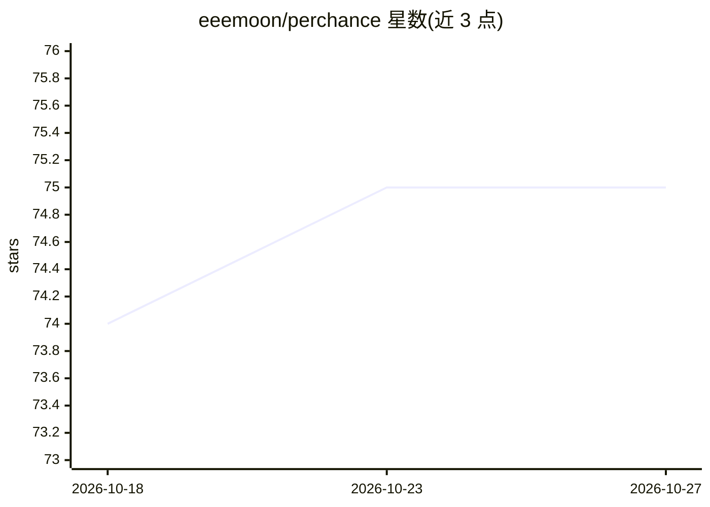

# eeemoon/perchance

⭐ 75 · Python · Apache-2.0 · 推送 2026-06-08 · [GitHub](https://github.com/eeemoon/perchance) · 个人维护

**Perchance 非官方 Python API：文本与图像生成**

围绕 Perchance 平台的非官方 Python 库，提供 TextGenerator 与 ImageGenerator 两个接口，用户通过 Python 代码调用 Perchance 的文本生成与图像生成能力；图像示例中结合 PIL 处理输出。以 pip 方式安装（pip install perchance），README 附文本与图像生成的异步代码示例。属逆向/封装类接口，非 Perchance 官方产品。

## 筛选速览

| 维度 | 判定 | 备注 |
|---|---|---|
| AI 角色 | `ai-ecosystem` | LLM/agent 周边工具 |
| 许可风险 | `permissive` | Apache-2.0 |
| 部署形态 | `library` | 以包/库形式分发 |
| 模型依赖 | — | README 未给出锁定关系 |
| 硬件要求 | — | 无带数字的原话,不猜 |
| 安装摩擦 | `low` | 无编译、无系统依赖或容器化 |
| 成熟度 | — | 结构信号不足 |

## 能力要点

- TextGenerator 文本生成接口
- ImageGenerator 图像生成接口
- pip 一键安装，异步调用示例

## 适用场景

- 在 Python 项目中调用 Perchance 生成文本
- 通过代码批量生成图像并用 PIL 处理

## 场景标签

`图像生成` · 领域:内容生成

## 证据(README 行号)

> L6: Unofficial Python API for Perchance.
> L27: from perchance import ImageGenerator

## 星数曲线

2026-10-18 74 → 2026-10-27 75（+1）

---
*卡片 v1 · prompt 1.4 · 生成 2026-10-24 · 置信度 mid · 依据 README sha `18322ff79dcd` · [字段定义](../../DATASET.md)*
