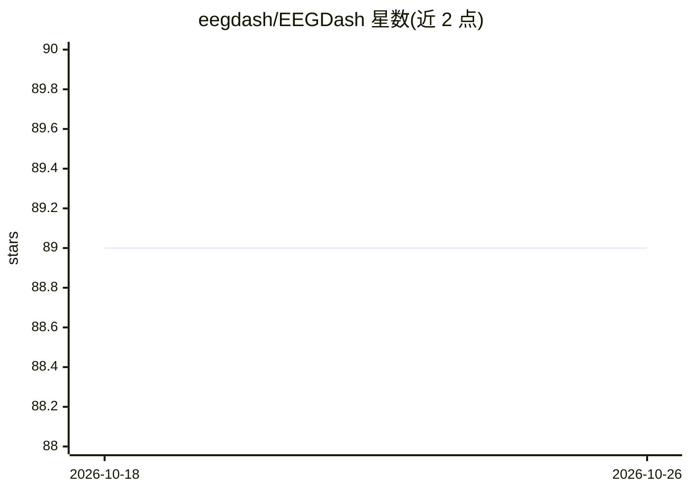

# eegdash/EEGDash

⭐ 89 · Python · BSD-3-Clause · 推送 2026-10-24 · [GitHub](https://github.com/eegdash/EEGDash) · [官网](http://eegdash.org/) · 组织维护

**面向机器学习的 EEG/MEG 数据目录与 PyTorch 数据集库（700+ 数据集）**

EEG-DaSh 是 MEEG（EEG、MEG） recordings 的数据共享归档与 Python 库：聚合 25 个实验室、27,053 名被试（含健康对照与 ADHD、抑郁、精神分裂症等临床组）的数据，另含 330 个从 NEMAR 转换的 BIDS 格式数据集。查询结果返回 PyTorch Dataset，可直接接入 DataLoader 进行批处理与并行加载；数据集即 braindecode 数据集，支持其全部预处理方式。需 Python 3.10+，通过 pip 安装。由 UCSD Swartz 中心与本古里安大学合作，NSF 支持。

## 筛选速览

| 维度 | 判定 | 备注 |
|---|---|---|
| AI 角色 | `ai-knowledge` | 知识聚合/清单类 |
| 许可风险 | `permissive` | BSD-3-Clause |
| 部署形态 | `library` | 以包/库形式分发 |
| 模型依赖 | — | README 未给出锁定关系 |
| 硬件要求 | — | 无带数字的原话,不猜 |
| 安装摩擦 | `low` | 无编译、无系统依赖或容器化 |
| 成熟度 | — | 结构信号不足 |

## 能力要点

- 聚合 25 个实验室、27,053 名被试的 EEG/MEG 数据
- 330 个 BIDS 格式数据集转换自 NEMAR
- 查询返回 PyTorch Dataset，可直接用于 DataLoader 训练
- 兼容 braindecode 全部预处理方法

## 适用场景

- 用现成 PyTorch Dataset 训练 EEG/MEG 深度学习模型
- 查找含临床组（ADHD、抑郁等）的脑电数据集
- 获取 BIDS 格式、可直接加载的脑信号数据

## 场景标签

 · 领域:神经科学/脑信号数据基础设施

## 证据(README 行号)

> L11: EEG-DaSh is a data-sharing archive for MEEG (EEG, MEG) recordings contributed by collaborating labs. It preserves p
> L19: EEGDash queries return a **PyTorch Dataset**. The format plugs directly into PyTorch's `DataLoader` for batching, s

## 星数曲线

2026-10-18 89 → 2026-10-26 89（+0）

---
*卡片 v1 · prompt 1.4 · 生成 2026-10-23 · 置信度 high · 依据 README sha `f5ab6ccbfd33` · [字段定义](../../DATASET.md)*
