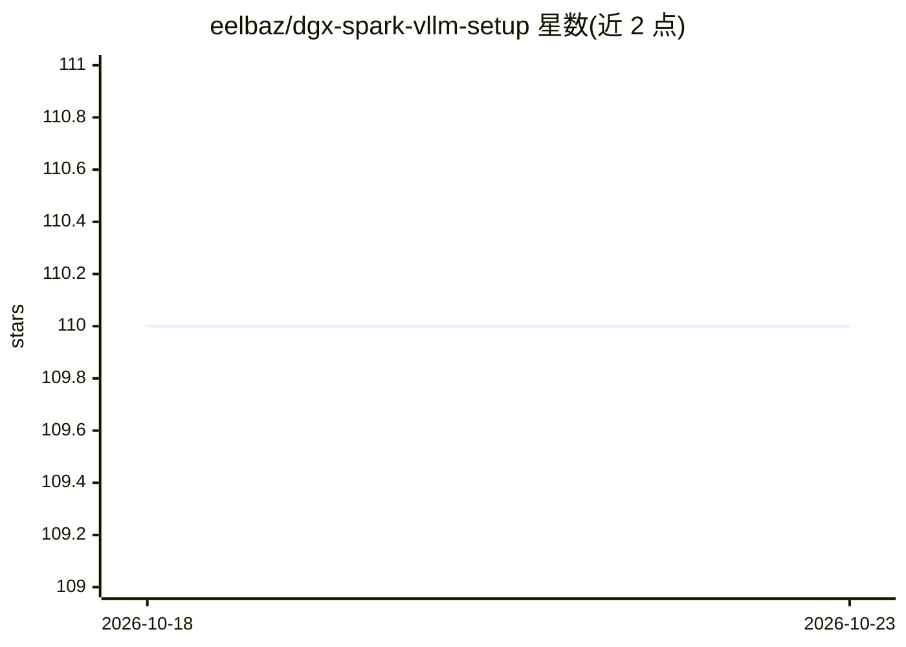

# eelbaz/dgx-spark-vllm-setup

⭐ 110 · Shell · MIT · 推送 2025-10-28 · [GitHub](https://github.com/eelbaz/dgx-spark-vllm-setup) · 个人维护

**NVIDIA DGX Spark (GB10) 上一键安装 vLLM 的脚本**

面向 NVIDIA DGX Spark（Blackwell GB10, sm_121）的一键安装脚本仓库：通过 install.sh 自动完成 vLLM 0.11.1rc 的源码构建，包含 CUDA 13.0 支持、SM100/SM120 MOE 内核的 CMake 修复、Triton 3.5.0 主干构建（针对 sm_121a）、PyTorch 2.9.0+cu130 及多项补丁与变通方案。安装约需 20-30 分钟（主要为编译）、约 50GB 磁盘。附带 vLLM 服务器启停/状态脚本、多节点集群配置指引（CLUSTER.md）与手动安装说明。仅适用于 DGX Spark 硬件，需 Ubuntu 22.04+ 与 CUDA 13.0+ 驱动。

## 筛选速览

| 维度 | 判定 | 备注 |
|---|---|---|
| AI 角色 | `ai-ecosystem` | LLM/agent 周边工具 |
| 许可风险 | `permissive` | MIT |
| 部署形态 | `None` |  |
| 模型依赖 | local-ok | 支持本地模型 |
| 硬件要求 | — | 无带数字的原话,不猜 |
| 安装摩擦 | `medium` | 含编译或系统依赖之一 |
| 成熟度 | — | 结构信号不足 |

## 能力要点

- 单条 curl 命令完成 vLLM 在 GB10 上的源码构建
- 自动应用 SM100/SM120 MOE 内核、Triton 路由 API 等多项修复补丁
- 附带 vllm-serve/status/stop 服务器管理脚本与环境激活脚本
- 提供多节点集群模式配置指引

## 适用场景

- 在 DGX Spark 上部署 vLLM 推理服务器
- 运行 Qwen3/gpt-oss 等 MOE 架构模型（Blackwell 适配）
- 多节点 DGX Spark 组建 vLLM 集群

## 场景标签

`推理引擎` · 领域:训练与推理

## 证据(README 行号)

> L3: **One-command installation** of vLLM for NVIDIA DGX Spark systems with GB10 GPUs (Blackwell architecture, sm_121).
> L5: This repository provides a dgx-spark tested, ready setup script that handles all the complexities of building vLLM o

## 星数曲线

2026-10-18 110 → 2026-10-23 110（+0）

---
*卡片 v1 · prompt 1.4 · 生成 2026-10-23 · 置信度 high · 依据 README sha `1fd528a9317c` · [字段定义](../../DATASET.md)*
