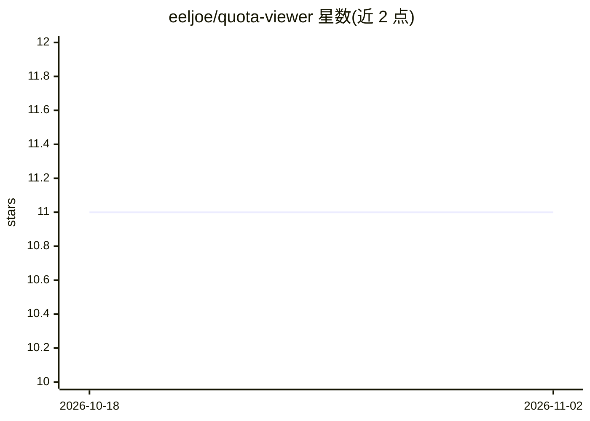

# eeljoe/quota-viewer

⭐ 11 · Go · MIT · 推送 2026-10-30 · [GitHub](https://github.com/eeljoe/quota-viewer) · 个人维护 · 中文 README

**桌面悬浮球：实时监控 11 个 AI 平台的配额与余额**

Go + Wails 编写的 Windows 桌面工具（约 11.1 MB 单文件、约 66 MB 内存），以悬浮球加展开面板形式展示 Kimi、DeepSeek、Ollama、MiniMax、Devin 等 11 个 AI 平台的 API 配额/余额剩余；每格颜色表示状态，默认 15 分钟自动刷新，支持多凭证组、预算进度条、系统托盘。另提供无头 CLI 探针，输出单行 JSON 供脚本和状态栏使用。仅支持 Windows 10+（需 WebView2 Runtime），为非官方工具，Cookie 凭证存在本地不上传。

## 筛选速览

| 维度 | 判定 | 备注 |
|---|---|---|
| AI 角色 | `ai-ecosystem` | LLM/agent 周边工具 |
| 许可风险 | `permissive` | MIT |
| 部署形态 | `desktop` | 安装包/桌面程序 |
| 模型依赖 | local-ok | 支持本地模型 |
| 硬件要求 | — | 无带数字的原话,不猜 |
| 安装摩擦 | `low` | 无编译、无系统依赖或容器化 |
| 成熟度 | — | 结构信号不足 |

## 能力要点

- 覆盖 11 个 AI 平台的配额/余额监控，每对象一格，颜色表示状态
- 悬浮球最多 9 个对象（扩展模式 16），超出折叠为 +N 格
- 无头 CLI 探针输出单行 JSON（schema: 2）
- 注册表驱动架构：新增平台只需 fetcher 实现 + 注册项，零前端改动

## 适用场景

- 在桌面实时盯多个 AI 平台的剩余配额，避免耗尽
- 用 CLI 探针把配额数据接入状态栏或脚本
- 为多个 API Key / 多套餐分别配置监控单元

## 场景标签

 · 领域:AI 平台监控/桌面工具

## 证据(README 行号)

> L5: A desktop floating ball + AI platform quota monitoring tool: displays API quota / balance remaining for various AI p
> L33: |Provider|Credential|Type|Displays|
> L120: This is an **unofficial** tool, not affiliated with any platform. Platform web structures and APIs may change at a

## 星数曲线

2026-10-18 11 → 2026-11-02 11（+0）

---
*卡片 v1 · prompt 1.4 · 生成 2026-11-02 · 置信度 mid · 依据 README sha `b1053292f12e` · [字段定义](../../DATASET.md)*
