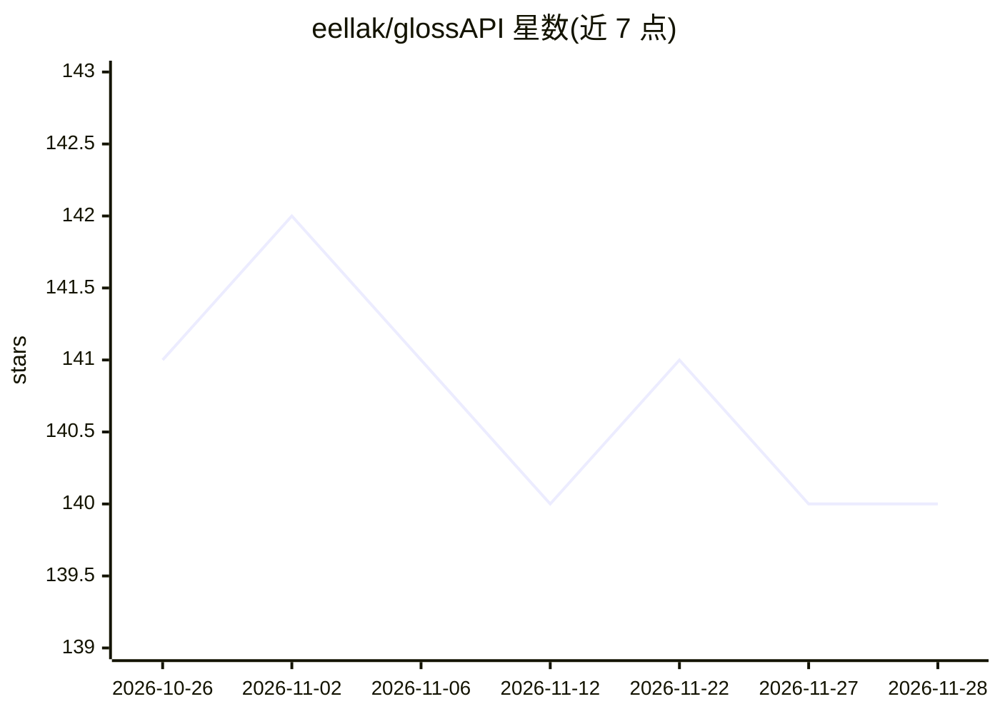

# eellak/glossAPI

⭐ 140 · Python · NOASSERTION · 推送 2026-11-09 · [GitHub](https://github.com/eellak/glossAPI) · [官网](https://glossapi.gr/) · 组织维护

**把学术 PDF 批量转为结构化 Markdown 与语料数据的处理管线**

GFOSS 维护的文档处理管线，通过 Corpus API 或 CLI 将学术 PDF 依次经过下载、文本提取、清洗、分节、标注并导出 JSONL/Markdown。0.2.0 版默认使用希腊 OCR 工具包作为唯一支持的 OCR 引擎，核心提取基于 PDFium 与内置 Rust 扩展，无需 Docling 或 GPU；支持按域缓存的浏览器辅助下载、断点续跑（corpus.sqlite3 台账）、可选 Docling 布局与数学/代码增强。安装需源码构建，依赖 Rust 与 C 工具链，Python 3.11–3.14。

## 筛选速览

| 维度 | 判定 | 备注 |
|---|---|---|
| AI 角色 | `ai-native` | 本体是模型或模型工具 |
| 许可风险 | `none` | NOASSERTION |
| 部署形态 | `library` | 以包/库形式分发 |
| 模型依赖 | — | README 未给出锁定关系 |
| 硬件要求 | — | 无带数字的原话,不猜 |
| 安装摩擦 | `medium` | 含编译或系统依赖之一 |
| 成熟度 | — | 结构信号不足 |

## 能力要点

- Corpus API 链式阶段调用（download/extract/clean/ocr/section/annotate/jsonl）与 CLI（glossapi plan/run）
- corpus.sqlite3 台账记录各阶段，支持中断续跑（--resume RUN_ID）
- 三种下载路由：直接 HTTP、auto 混合、浏览器辅助，仅限公开目标
- 默认 OCR 为希腊语工具包（R8 分段器 + x1 识别器，版本固定）

## 适用场景

- 批量下载公开学术 PDF 并转成训练用 JSONL 语料
- 对扫描版希腊语文档做 OCR 与清洗
- 需要可恢复的长时批量文档处理任务

## 场景标签

`OCR` `文档解析` · 领域:知识与检索

## 证据(README 行号)

> L3: GlossAPI is GFOSS's document-processing pipeline for turning academic PDFs into structured Markdown, cleaned text, s
> L7: **GlossAPI 0.2.0 uses the Greek OCR toolkit as its only supported OCR engine.**
> L41: `Corpus` is the organizing surface: keep contributions wired through `Corpus.run()` and the phase methods (`downloa

## 星数曲线

2026-10-26 141 → 2026-11-28 140（-1）

---
*卡片 v1 · prompt 1.4 · 生成 2026-11-27 · 置信度 high · 依据 README sha `5247c96808dc` · [字段定义](../../DATASET.md)*
