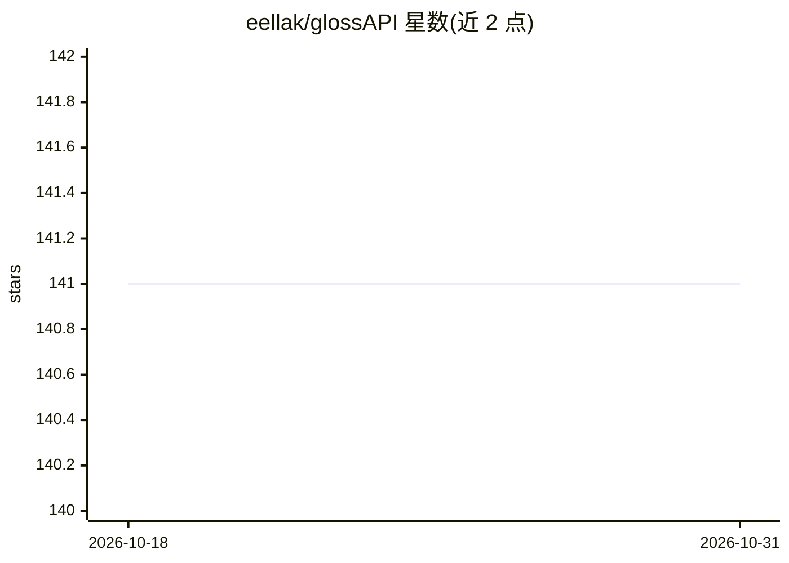

# eellak/glossAPI

⭐ 141 · Python · NOASSERTION · 推送 2026-10-06 · [GitHub](https://github.com/eellak/glossAPI) · [官网](https://glossapi.gr/) · 组织维护

**把学术 PDF 转成结构化 Markdown 的数据集生产流水线**

GFOSS 开发的 GPU 文档处理流水线：从下载、抽取（PyPDFium/Docling/RapidOCR）、Rust 扩展清洗、分节、标注到 JSONL 导出，把学术 PDF 转成结构化 Markdown，可选通过 DeepSeek-OCR（配合 vLLM）做 OCR 与数学内容增强。面向希腊语优先的学术语料做了元数据与分节分类调优，供数据集构建与 LLM 训练导出使用。提供 pip 安装、按模式自动配置环境的脚本与 conda 方案，许可为 EUPL 1.2。

## 筛选速览

| 维度 | 判定 | 备注 |
|---|---|---|
| AI 角色 | `ai-ecosystem` | LLM/agent 周边工具 |
| 许可风险 | `none` | NOASSERTION |
| 部署形态 | `library` | 以包/库形式分发 |
| 模型依赖 | local-ok | 支持本地模型 |
| 硬件要求 | — | 无带数字的原话,不猜 |
| 安装摩擦 | `medium` | 含编译或系统依赖之一 |
| 成熟度 | — | 结构信号不足 |

## 能力要点

- 下载→抽取→清洗→OCR→分节→标注→JSONL 导出的可断点续跑流水线
- Rust 扩展实现清洗与噪声度量
- DeepSeek-OCR/vLLM GPU 后端与 RapidOCR 高吞吐 OCR 支持
- 希腊语优先的元数据与分节分类

## 适用场景

- 把学术 PDF 批量转成 Markdown 数据集
- 为 LLM 训练导出带标注分节的 JSONL 语料
- 对含公式/代码的文档做数学内容增强与 LaTeX 映射

## 场景标签

`文档解析` · 领域:知识与检索

## 证据(README 行号)

> L3: GlossAPI is a GPU-ready document processing pipeline from GFOSS that turns academic PDFs into structured Markdown, c

## 星数曲线

2026-10-18 141 → 2026-10-31 141（+0）

---
*卡片 v1 · prompt 1.4 · 生成 2026-10-23 · 置信度 high · 依据 README sha `db4ab5428a83` · [字段定义](../../DATASET.md)*
