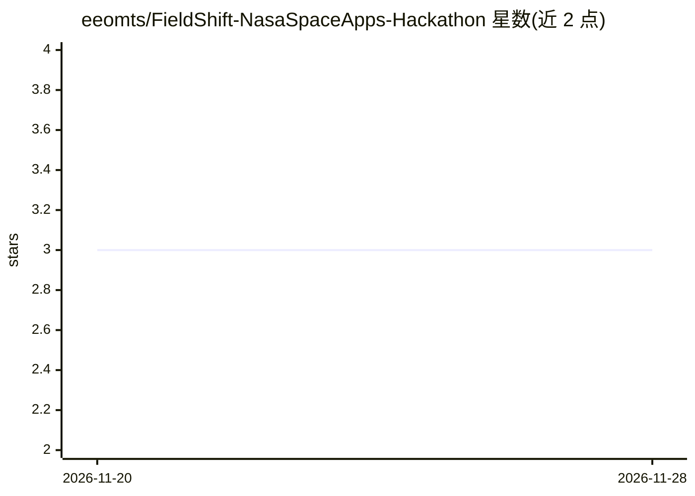

# eeomts/FieldShift-NasaSpaceApps-Hackathon

⭐ 3 · Python · 推送 2026-11-16 · [GitHub](https://github.com/eeomts/FieldShift-NasaSpaceApps-Hackathon) · [官网](https://agroai.mateusmoreira.dev) · 组织维护

**面向巴西与美国中小农户的轮作决策支持网站**

为巴西和美国中小农户提供轮作决策支持的移动端网站，英文与葡萄牙文双语。流程为问卷→仪表盘→轮作对比→对话助手；仪表盘展示 NASA POWER 气候历史、SMAP 土壤湿度、MODIS NDVI、GPM IMERG 降雨、SRTM 坡度等数据。轮作引擎给出当前轮作与两个替代方案的对比，每项数字均标注来源与时期；Gemini 仅用于读取自由文本与驱动聊天解释，不计算或生成数字。服务器读取 SMAP/MODIS/GPM 需 Earthdata token，无 token 时降雨卡片回退到 NASA POWER。

## 筛选速览

| 维度 | 判定 | 备注 |
|---|---|---|
| AI 角色 | `ai-native` | 本体是模型或模型工具 |
| 许可风险 | `none` | — |
| 部署形态 | `self-host` | docker 或自建部署 |
| 模型依赖 | — | README 未给出锁定关系 |
| 硬件要求 | — | 无带数字的原话,不猜 |
| 安装摩擦 | `low` | 无编译、无系统依赖或容器化 |
| 成熟度 | — | 结构信号不足 |

## 能力要点

- 读取 NASA POWER/SRTM/SMAP/MODIS/GPM IMERG 五类地球观测数据
- 轮作对比附带建议理由、证据、收益、风险、置信度与信息缺口
- 聊天助手引用每个数字的来源与时期，不计算或编造数值
- 英葡双语移动端网站并提供在线演示

## 适用场景

- 农户结合 NASA 卫星数据比较轮作方案
- 用聊天助手以通俗语言了解农场气候与作物信息
- 查看农场土壤湿度、NDVI、降雨的近期卫星读数

## 场景标签

`RAG` `聊天机器人` · 领域:对话与助手

## 证据(README 行号)

> L15: A mobile-first website, in English and Portuguese, for farmers in Brazil and the United States:
> L20: 4. **Chat assistant** that explains the comparison, the farm's climate and the crops in plain language, and cites t
> L69: React, Vite, TypeScript, Tailwind CSS, Leaflet, Python, FastAPI, SQLAlchemy, Alembic, PostgreSQL + pgvector, Google

## 星数曲线

2026-11-20 3 → 2026-11-28 3（+0）

---
*卡片 v1 · prompt 1.4 · 生成 2026-11-22 · 置信度 high · 依据 README sha `2dde9d7d35a0` · [字段定义](../../DATASET.md)*
