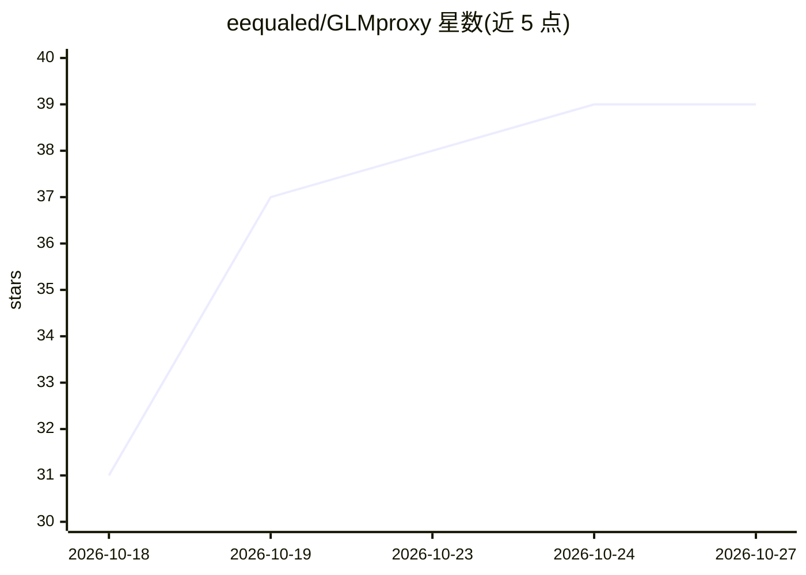

# eequaled/GLMproxy

⭐ 39 · JavaScript · MIT · 推送 2026-10-17 · [GitHub](https://github.com/eequaled/GLMproxy) · 个人维护 · 中文 README

**本地代理：把 AutoClaw 内的智谱 GLM 模型暴露为 OpenAI/Anthropic API**

Node.js 编写的本地 API 代理，连接 AutoClaw 后端与 OpenAI/Anthropic 两种 API 方言，使 Claude Code、Cursor、Continue、OpenCode 及各 SDK 可调用 AutoClaw 提供的 GLM-5.3、GLM-5-Turbo、DeepSeek 等模型。认证由 AutoClaw 自动处理（含 2.x 加密 vault 的平台级解密），模型目录从运行时快照动态读取。上游限制单账号 1 并发，代理内置 FIFO 队列串行化请求并带限流重试；Linux 需另装 curl_cffi 匹配 TLS 指纹。需 Node.js 18+ 且 AutoClaw 已登录运行。

## 筛选速览

| 维度 | 判定 | 备注 |
|---|---|---|
| AI 角色 | `ai-ecosystem` | LLM/agent 周边工具 |
| 许可风险 | `permissive` | MIT |
| 部署形态 | `library` | 以包/库形式分发 |
| 模型依赖 | — | README 未给出锁定关系 |
| 硬件要求 | — | 无带数字的原话,不猜 |
| 安装摩擦 | `low` | 无编译、无系统依赖或容器化 |
| 成熟度 | — | 结构信号不足 |

## 能力要点

- 同一 CLI 同时提供 OpenAI Chat Completions 与 Anthropic Messages 两种 API 格式（端口 18791/18792）
- Claude 模型名自动映射到 GLM 模型，按 opus/sonnet/haiku 信用层级路由
- 内置 FIFO 串行队列，规避上游单账号 1 并发限制导致的 406 错误
- 模型目录从 AutoClaw 运行时快照动态读取，增删模型无需重启代理

## 适用场景

- 在 Claude Code、Cursor、Continue、OpenCode 中使用 AutoClaw 的 GLM 模型
- 让现有 OpenAI/Anthropic SDK 程序直接调用 AutoClaw 后端
- 用 --doctor / --test-models 检查 AutoClaw 模型目录健康状态

## 场景标签

`模型网关` · 领域:Agent 开发

## 证据(README 行号)

> L3: **GLM Proxy (`glmproxy`)** is a local Node.js API proxy for AutoClaw's Zhipu AI GLM models. It exposes OpenAI-compat
> L100: AutoClaw gives you Zhipu's GLM models (GLM-5.3, GLM-5-Turbo, GLM-5.3-Flash, plus DeepSeek), but locks them inside 

## 星数曲线

2026-10-18 31 → 2026-10-27 39（+8）

---
*卡片 v1 · prompt 1.4 · 生成 2026-10-25 · 置信度 mid · 依据 README sha `16d477655bf5` · [字段定义](../../DATASET.md)*
