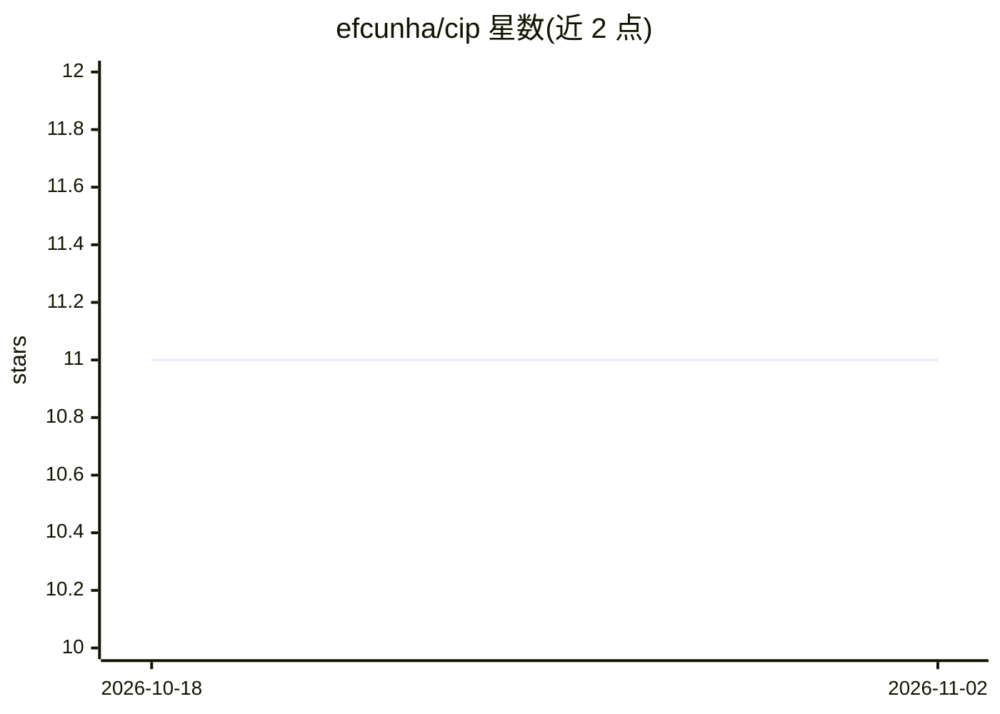

# efcunha/cip

⭐ 11 · Python · 推送 2026-10-30 · [GitHub](https://github.com/efcunha/cip) · 个人维护

**面向 AWS/GCP/Azure 的 LLM 云架构分析与审查平台**

基于 FastAPI 的多专家 LLM 应用：以 pgvector 向量库存放三大云官方文档（RAG），编排器将请求路由到 11 个领域专家（3 云平台 + Kubernetes/Terraform/FinOps/安全等 8 个领域），实时数据（价格、库存、建议）通过只读工具从 Cost Explorer、Azure Advisor、GCP Recommender 获取而非模型推断。包含 14 条 Inspection 规则（7 Terraform + 7 Kubernetes）、质量评估关卡与 MCP Server 供 Cursor/Claude 等外部 agent 调用，部署采用 podman compose。README 为葡语（附英文版）。

## 筛选速览

| 维度 | 判定 | 备注 |
|---|---|---|
| AI 角色 | `ai-native` | 本体是模型或模型工具 |
| 许可风险 | `none` | — |
| 部署形态 | `None` |  |
| 模型依赖 | — | README 未给出锁定关系 |
| 硬件要求 | — | 无带数字的原话,不猜 |
| 安装摩擦 | `medium` | 含编译或系统依赖之一 |
| 成熟度 | — | 结构信号不足 |

## 能力要点

- RAG + pgvector 索引 4,785 个云文档 chunk，回答附官方来源引用
- 11 个领域专家路由（AWS/GCP/Azure/K8s/Terraform/FinOps 等）
- 实时数据全部来自只读工具，默认零生产写权限
- MCP Server 将平台暴露为 Cursor/Kiro/Claude 等外部 agent 的工具

## 适用场景

- 分析云环境、审查 IaC 与 Kubernetes 配置并检测风险
- 获取带官方来源引用的架构、安全与成本优化建议
- 在 IDE agent（Cursor/Claude）中调用云领域专家能力

## 场景标签

`RAG` `代码审查` · 领域:编码与开发

## 证据(README 行号)

> L3: LLM especialista em **AWS, GCP e Azure** que atua como um **engenheiro de cloud sênior**:
> L24: 1. **RAG é o cérebro** — conhecimento das clouds indexado em `pgvector`, não gravado no modelo.
> L35: Usuário ─► API (FastAPI) ─► Orquestrador ─┬─► Retriever ─► pgvector (docs oficiais)

## 星数曲线

2026-10-18 11 → 2026-11-02 11（+0）

---
*卡片 v1 · prompt 1.4 · 生成 2026-11-02 · 置信度 high · 依据 README sha `5e90f197e20a` · [字段定义](../../DATASET.md)*
