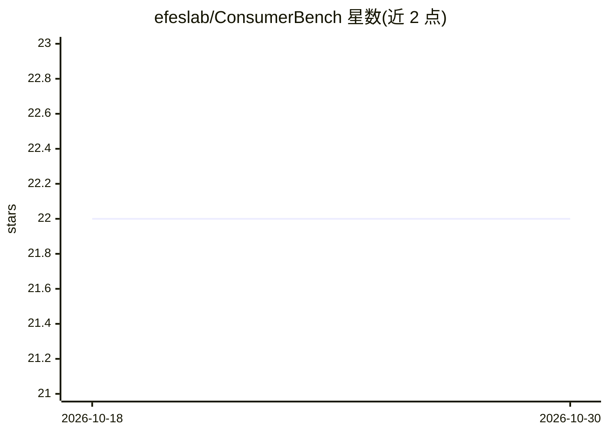

# efeslab/ConsumerBench

⭐ 22 · Python · MIT · 推送 2026-08-20 · [GitHub](https://github.com/efeslab/ConsumerBench) · [官网](https://consumerbench.github.io/) · 组织维护

**端侧 GenAI 应用的运行时性能基准测试框架**

面向终端用户设备，评估用户自定义 GenAI 应用在真实条件下的运行时性能。内置四类应用：Chatbot（llama.cpp 后端、模拟 OpenAI API）、DeepResearch（基于 open-deep-research、经 LiteLLM 提供服务）、ImageGen（stable-diffusion-webui API 模式）、LiveCaptions（Whisper HTTP 转录）。通过 Python 脚本按 YAML 配置运行工作流，采集 GPU/CPU 利用率、内存带宽、功耗（DCGM/NVML/RAPL/pcm-memory）等系统指标，支持独占、并发、模型共享等实验配置，自动生成结果图。

## 筛选速览

| 维度 | 判定 | 备注 |
|---|---|---|
| AI 角色 | `ai-ecosystem` | LLM/agent 周边工具 |
| 许可风险 | `permissive` | MIT |
| 部署形态 | `None` |  |
| 模型依赖 | — | README 未给出锁定关系 |
| 硬件要求 | — | 无带数字的原话,不猜 |
| 安装摩擦 | `low` | 无编译、无系统依赖或容器化 |
| 成熟度 | — | 结构信号不足 |

## 能力要点

- 内置 Chatbot/DeepResearch/ImageGen/LiveCaptions 四类端侧 GenAI 应用
- 采集 GPU/CPU 利用率、内存带宽与功耗等系统指标
- 支持独占执行、并发执行（贪心分配/GPU 分区）与模型共享配置
- 结果自动保存并生成 PDF 图表，SLO 可自定义

## 适用场景

- 评测端侧设备上 GenAI 应用的延迟与资源开销
- 比较多应用并发运行时的资源竞争表现
- 为硬件选型或系统调优提供量化数据

## 场景标签

`模型评测` · 领域:评测与运维

## 证据(README 行号)

> L5: ConsumerBench is a comprehensive benchmarking framework that evaluates the runtime performance of user-defined GenAI
> L52: - Powered by llama.cpp for efficient CPU-GPU co-execution

## 星数曲线

2026-10-18 22 → 2026-10-30 22（+0）

---
*卡片 v1 · prompt 1.4 · 生成 2026-10-27 · 置信度 high · 依据 README sha `6dee6e171d1b` · [字段定义](../../DATASET.md)*
