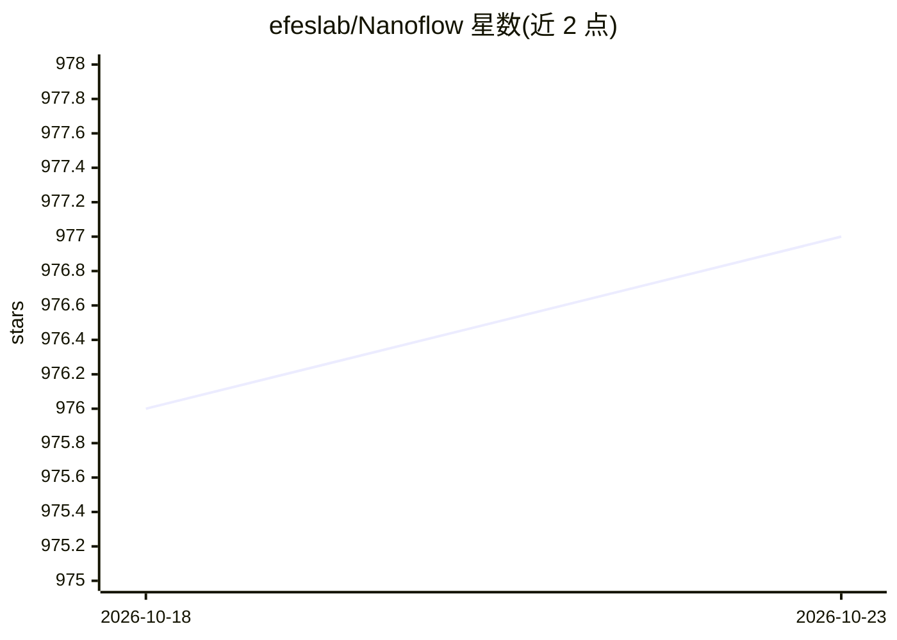

# efeslab/Nanoflow

⭐ 977 · Jupyter Notebook · 推送 2026-03-29 · [GitHub](https://github.com/efeslab/Nanoflow) · [官网](https://arxiv.org/abs/2408.12757) · 组织维护

**面向吞吐的 LLM 推理服务框架（研究原型，论文配套）**

NanoFlow 是 C++ 后端 + Python 前端（约 4K 行）的 LLM 服务框架，面向吞吐优化：通过 nano-batching 与执行单元调度实现设备内并行，重叠计算/内存/网络操作；采用异步 CPU 调度控制流做批形成与 KV-cache 管理；将完成请求的 KV-cache 逐层卸载到 SSD 以复用多轮对话。README 给出在 8xA100 上与 vLLM、Deepspeed-FastGen、TensorRT-LLM 的对比评测数据（1.91x 吞吐提升），支持 Llama2/3 70B、Llama3 8B、Qwen2 72B 等模型。安装需 Docker + Gurobi 学术许可 + 源码编译。

## 筛选速览

| 维度 | 判定 | 备注 |
|---|---|---|
| AI 角色 | `ai-ecosystem` | LLM/agent 周边工具 |
| 许可风险 | `none` | — |
| 部署形态 | `self-host` | docker 或自建部署 |
| 模型依赖 | — | README 未给出锁定关系 |
| 硬件要求 | — | 无带数字的原话,不猜 |
| 安装摩擦 | `low` | 无编译、无系统依赖或容器化 |
| 成熟度 | — | 结构信号不足 |

## 能力要点

- nano-batching 与执行单元调度实现设备内并行
- 异步 CPU 调度：批形成与 KV-cache 管理与 GPU 执行重叠
- KV-cache 逐层卸载至 SSD 以复用多轮对话
- C++ 后端 + Python 前端，集成 CUTLASS/FlashInfer/MSCCL++

## 适用场景

- 在 NVIDIA GPU 集群上运行 LLM 推理服务并对比吞吐
- 复现论文中的离线吞吐与在线延迟评测
- 研究服务框架的设备内并行与调度技术

## 场景标签

`推理引擎` · 领域:训练与推理

## 证据(README 行号)

> L7: NanoFlow is a throughput-oriented high-performance serving framework for LLMs. NanoFlow consistently delivers superi
> L35: With all mentioned techniques implemented, we now open-source NanoFlow of a Cpp-based backend and a Python-based de

## 星数曲线

2026-10-18 976 → 2026-10-23 977（+1）

---
*卡片 v1 · prompt 1.4 · 生成 2026-10-21 · 置信度 high · 依据 README sha `47f2c4d7ca62` · [字段定义](../../DATASET.md)*
