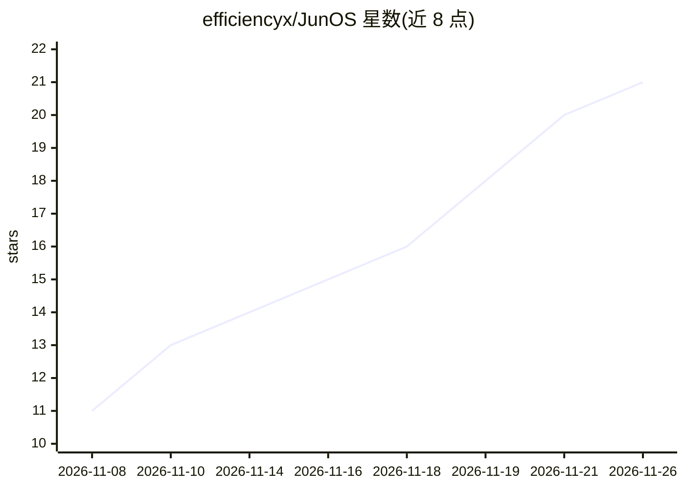

# efficiencyx/JunOS

⭐ 21 · JavaScript · Apache-2.0 · 推送 2026-11-24 · [GitHub](https://github.com/efficiencyx/JunOS) · [官网](https://junos.andrealab.it) · 个人维护

**自托管 AI 伴侣：与游戏角色 Jun 对话、语音与养成互动**

面向玩家的非官方自托管 Web 应用，将游戏《Factorial Omega: My Dystopian Robot Girlfriend》中的角色 Jun 以 AI 伴侣形式运行：Live2D 动画、语音对话、情感/信任数值、持久记忆与日记、共同活动（购物/卡拉OK/餐厅/二十一点）、游戏存档互通（JunBridge mod）、9 种界面语言。推理默认在本地设备完成（Ollama/llama.cpp 等本地后端，云端模式经 Colab 仅推理）。Windows 提供安装 exe 直接运行（不依赖 Docker），Linux/macOS/WSL 通过脚本 + Docker 安装。基于 18+ 游戏，可配置生成成人内容。

## 筛选速览

| 维度 | 判定 | 备注 |
|---|---|---|
| AI 角色 | `ai-native` | 本体是模型或模型工具 |
| 许可风险 | `permissive` | Apache-2.0 |
| 部署形态 | `desktop` | 安装包/桌面程序 |
| 模型依赖 | local-ok | 支持本地模型 |
| 硬件要求 | — | 无带数字的原话,不猜 |
| 安装摩擦 | `low` | 无编译、无系统依赖或容器化 |
| 成熟度 | — | 结构信号不足 |

## 能力要点

- Live2D 角色与语音对话，支持本地语音输入与直接音频感知
- 好感/信任/紧张数值与持久记忆、日记系统，可读取并回写游戏存档
- 三种安装模式（Express/Custom/Cloud）与三个发布渠道（Stable/Latest/Experimental）
- 默认全部本地运行，无外部账号与云端推理

## 适用场景

- 在自己的电脑上与游戏角色 Jun 进行语音和文字对话
- 通过游戏存档互通与 JunBridge mod 让游戏内外记忆同步
- 在手机或无本地算力的机器上经 Colab 推理模式使用

## 场景标签

`聊天机器人` `语音 Agent` · 领域:对话与助手

## 证据(README 行号)

> L18: **Jun OS** is an unofficial, self-hosted **MDRG AI companion**: a simple orchestration system that brings **Jun** f
> L20: She can **talk, sing, express emotions, animate, remember things, have dinner with you, and actually take part in y
> L32: Basically, an AI wrapper with 50 other systems working together to make her feel real.

## 星数曲线

2026-11-08 11 → 2026-11-26 21（+10）

---
*卡片 v1 · prompt 1.4 · 生成 2026-11-18 · 置信度 mid · 依据 README sha `4ea01ca29043` · [字段定义](../../DATASET.md)*
