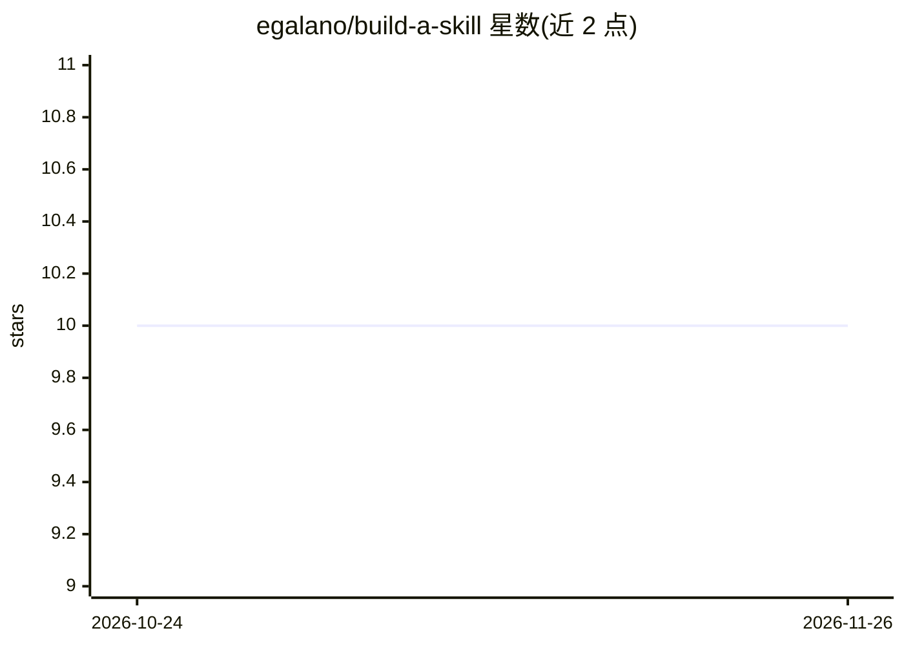

# egalano/build-a-skill

⭐ 10 · NOASSERTION · 推送 2026-05-22 · [GitHub](https://github.com/egalano/build-a-skill) · 个人维护

**交互式 Claude Skill，教你构建自己的 Claude Skill**

将 Anthropic《The Complete Guide to Building Skills for Claude》教程 PDF 封装为可对话交互的 Claude Skill：agent 通过诊断用户水平、提问选择题、协助撰写 YAML frontmatter 与 SKILL.md 正文、执行触发与功能测试、运行 pre-flight 检查单，引导用户在约 15-30 分钟内产出一个可安装的 SKILL.md 及 zip 包。内容为 Anthropic 教程的 MIT 许可衍生打包，声明与 Anthropic 无官方关联。

## 筛选速览

| 维度 | 判定 | 备注 |
|---|---|---|
| AI 角色 | `ai-knowledge` | 知识聚合/清单类 |
| 许可风险 | `none` | NOASSERTION |
| 部署形态 | `desktop` | 安装包/桌面程序 |
| 模型依赖 | — | README 未给出锁定关系 |
| 硬件要求 | — | 无带数字的原话,不猜 |
| 安装摩擦 | `low` | 无编译、无系统依赖或容器化 |
| 成熟度 | — | 结构信号不足 |

## 能力要点

- 将 33 页官方教程转化为对话式交互教学 Skill
- 采用渐进式披露结构：SKILL.md 入口 + references 分章材料
- 入门诊断与 Demo Mode（release-notes-writer 示例）
- 结束时生成真实 zip 并打印两条安装路径

## 适用场景

- 想让 agent 一步步带我做第一个 Claude Skill
- 在 Claude Code 里交互学习 Skill 格式与最佳实践
- 只想快速翻阅分章摘要而非读完整 PDF

## 场景标签

`教程课程` · 领域:学习与行业

## 证据(README 行号)

> L5: An interactive Claude Skill that walks you through designing, writing, testing, and distributing your own Skill for 
> L24: ├── SKILL.md                              # Interactive tutorial flow (entry point)

## 星数曲线

2026-10-24 10 → 2026-11-26 10（+0）

---
*卡片 v1 · prompt 1.4 · 生成 2026-11-19 · 置信度 high · 依据 README sha `b1207920b42b` · [字段定义](../../DATASET.md)*
