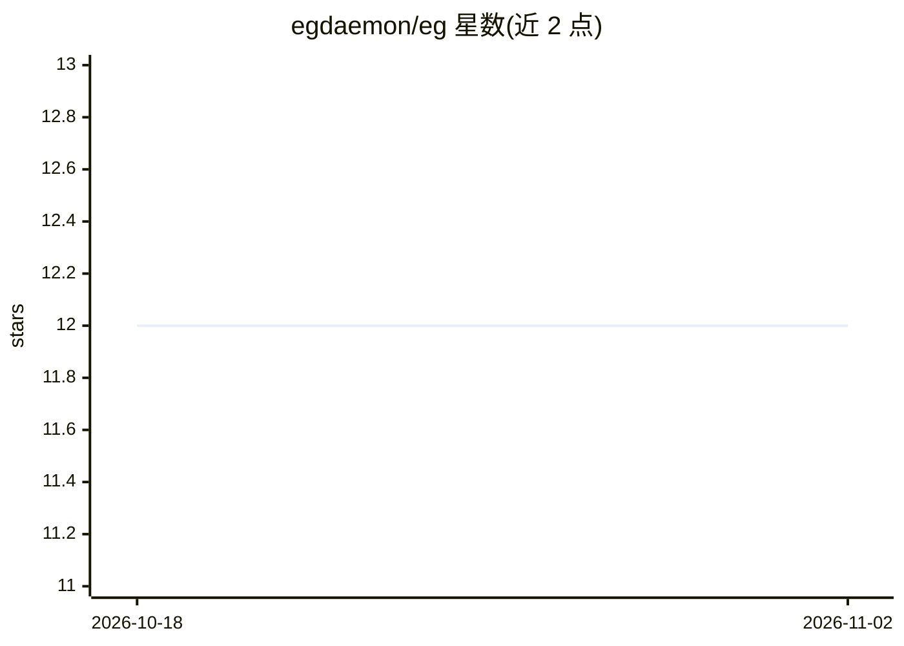

# egdaemon/eg

⭐ 12 · Go · NOASSERTION · 推送 2026-11-01 · [GitHub](https://github.com/egdaemon/eg) · [官网](https://egdaemon.com/) · 个人维护

**开发者导向的 CI/CD 与计算工作负载编排平台**

面向开发者的计算平台，定位覆盖 CI/CD、agent harnesses 与计算工作负载编排，声称支持开发、ML 训练、测试、软件包构建与部署的开发生命周期功能。机制上采用完全虚拟化的计算平台以实现高扩展性，采用本地优先设计使工作负载可本地运行也可进入编排层，并提供 Homelab 功能与安全关注。README 仅含功能列表与文档指引，未给出具体安装命令；后续细节指向发布公告与文档。

## 筛选速览

| 维度 | 判定 | 备注 |
|---|---|---|
| AI 角色 | `ai-ecosystem` | LLM/agent 周边工具 |
| 许可风险 | `none` | NOASSERTION |
| 部署形态 | `None` |  |
| 模型依赖 | — | README 未给出锁定关系 |
| 硬件要求 | — | 无带数字的原话,不猜 |
| 安装摩擦 | `low` | 无编译、无系统依赖或容器化 |
| 成熟度 | — | 结构信号不足 |

## 能力要点

- 覆盖开发、ML 训练、测试、包构建与部署的编排平台
- 完全虚拟化的计算平台，声称高度可扩展
- 本地优先设计，工作负载可在本地与编排层运行
- 包含 Homelab 功能类别

## 适用场景

- 在本地与编排层统一运行 CI/CD 工作负载
- 为开发流程编排 ML 训练与测试任务
- 个人开发者搭建 Homelab 计算环境

## 场景标签

`MLOps` · 领域:训练与推理

## 证据(README 行号)

> L3: the only developer productivity focused compute (ci/cd|agent harnesses|compute workload) platform. It focus' on day 
> L10: - [x] only compute platform that truly focuses on the development lifecycle providing functionality for development

## 星数曲线

2026-10-18 12 → 2026-11-02 12（+0）

---
*卡片 v1 · prompt 1.4 · 生成 2026-11-01 · 置信度 low · 依据 README sha `5a74146dd9c5` · [字段定义](../../DATASET.md)*
