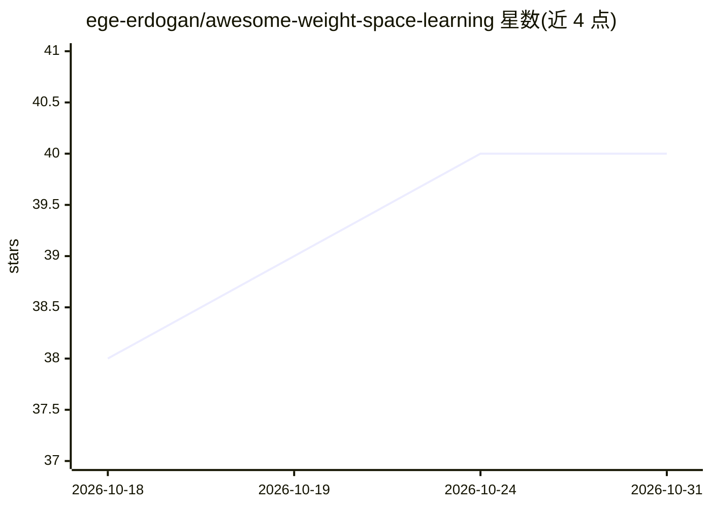

# ege-erdogan/awesome-weight-space-learning

⭐ 40 · 推送 2026-01-16 · [GitHub](https://github.com/ege-erdogan/awesome-weight-space-learning) · 个人维护

**权重空间学习论文清单：面向ML研究者汇集领域文献**

收录机器学习中 weight-space learning（学习神经网络权重函数）方向论文的策展清单，按架构/训练、权重空间生成模型、数据集、其他、硕博论文及博客演讲等板块组织，涵盖 2020-2025 年论文。清单自我声明非穷尽，接受 PR 补充。面向该方向的研究人员与研究生，用于文献调研。仅提供条目列举，无代码或安装内容。

## 筛选速览

| 维度 | 判定 | 备注 |
|---|---|---|
| AI 角色 | `ai-knowledge` | 知识聚合/清单类 |
| 许可风险 | `none` | — |
| 部署形态 | `None` |  |
| 模型依赖 | — | README 未给出锁定关系 |
| 硬件要求 | — | 无带数字的原话,不猜 |
| 安装摩擦 | `low` | 无编译、无系统依赖或容器化 |
| 成熟度 | — | 结构信号不足 |

## 能力要点

- 按架构/生成模型/数据集等 6 类板块组织论文条目
- 收录 2020-2025 年权重空间学习方向论文与学位论文
- 接受社区 PR 补充条目

## 适用场景

- 调研权重空间学习方向的代表论文
- 查找权重空间数据集相关文献
- 了解该方向的学位论文与研讨会资源

## 场景标签

`精选清单` · 领域:学习与行业

## 证据(README 行号)

> L1: # Awesome Weight Space Learning
> L5: Weight-space learning is a rapidly-growing area within machine learning, centered on learning functions of neural ne

## 星数曲线

2026-10-18 38 → 2026-10-31 40（+2）

---
*卡片 v1 · prompt 1.4 · 生成 2026-10-25 · 置信度 high · 依据 README sha `dcd6e0512d35` · [字段定义](../../DATASET.md)*
