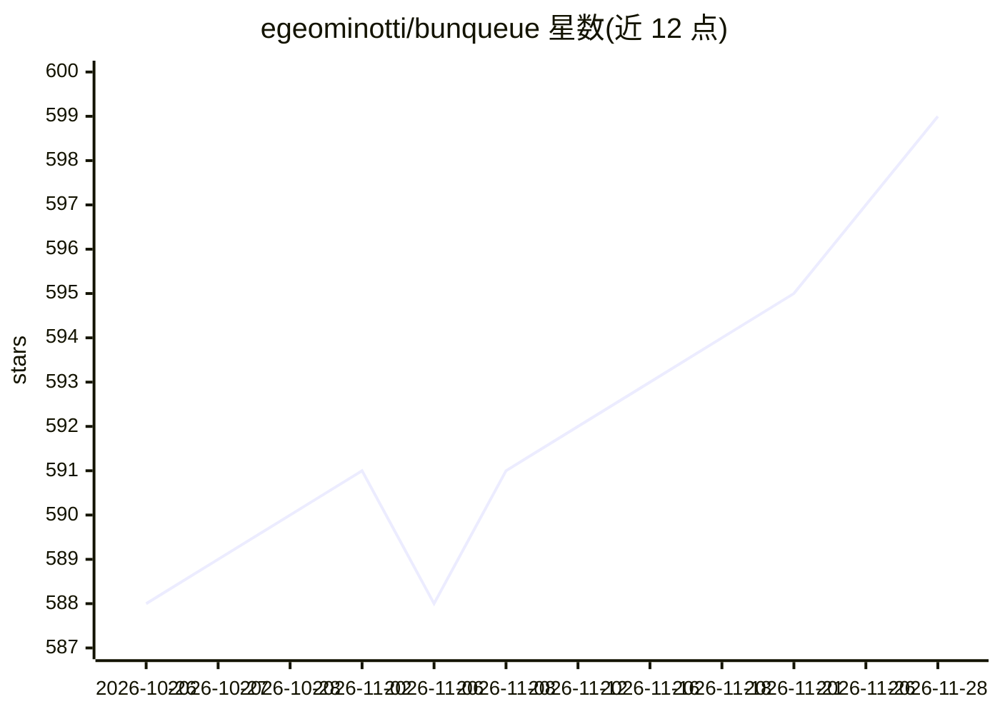

# egeominotti/bunqueue

⭐ 599 · TypeScript · MIT · 推送 2026-11-17 · [GitHub](https://github.com/egeominotti/bunqueue) · [官网](https://bunqueue.dev) · 个人维护

**面向 Bun 的作业队列：默认 SQLite，内置 MCP 供 AI 代理调度任务**

bunqueue 是一个运行于 Bun 的作业队列，提供两种模式：嵌入式（队列随应用进程运行，内存或单文件 SQLite 持久化）与独立 TCP 服务器（Docker 或独立可执行文件部署）。扩展场景提供 PostgreSQL 16–18 多 broker 模式。功能包括死信队列、cron 调度、重试与退避、优先级、速率限制、S3 备份；API 兼容 BullMQ/BullMQ Pro 的 Queue/Worker/FlowProducer 等接口。客户端覆盖 Node.js、Deno、Python、PHP、Go、Rust、Elixir。内置 79 个工具的 MCP 服务器，README 称面向 AI 代理与自动化场景；默认无 Redis 依赖。

## 筛选速览

| 维度 | 判定 | 备注 |
|---|---|---|
| AI 角色 | `ai-enhanced` | 去掉 AI 部分产品仍成立 |
| 许可风险 | `permissive` | MIT |
| 部署形态 | `self-host` | docker 或自建部署 |
| 模型依赖 | — | README 未给出锁定关系 |
| 硬件要求 | — | 无带数字的原话,不猜 |
| 安装摩擦 | `low` | 无编译、无系统依赖或容器化 |
| 成熟度 | — | 结构信号不足 |

## 能力要点

- 嵌入式（内存/单文件 SQLite）与独立 TCP 服务器两种运行模式
- PostgreSQL 16–18 多 broker 模式，支持多 broker 故障转移
- 内置 MCP 服务器（79 个工具），AI 代理可直接控制队列
- BullMQ / BullMQ Pro 兼容 API，多语言客户端

## 适用场景

- 给 AI 代理或自动化流程添加任务调度与后台作业
- 不想运维 Redis 的单机或嵌入式部署
- 用 PostgreSQL 多 broker 扩展多个 worker
- 从 BullMQ 迁移的队列项目

## 场景标签

`工作流自动化` · 领域:效率与自动化

## 证据(README 行号)

> L12:  DLQ, cron, SQLite S3 backups, and native MCP. Built for AI agents and automation. No Redis.
> L249: - **MCP server included** — 79 primary tools; AI agents get full queue control out of the box

## 星数曲线

2026-10-26 588 → 2026-11-28 599（+11）

---
*卡片 v1 · prompt 1.4 · 生成 2026-11-25 · 置信度 high · 依据 README sha `22772b2e7f39` · [字段定义](../../DATASET.md)*
