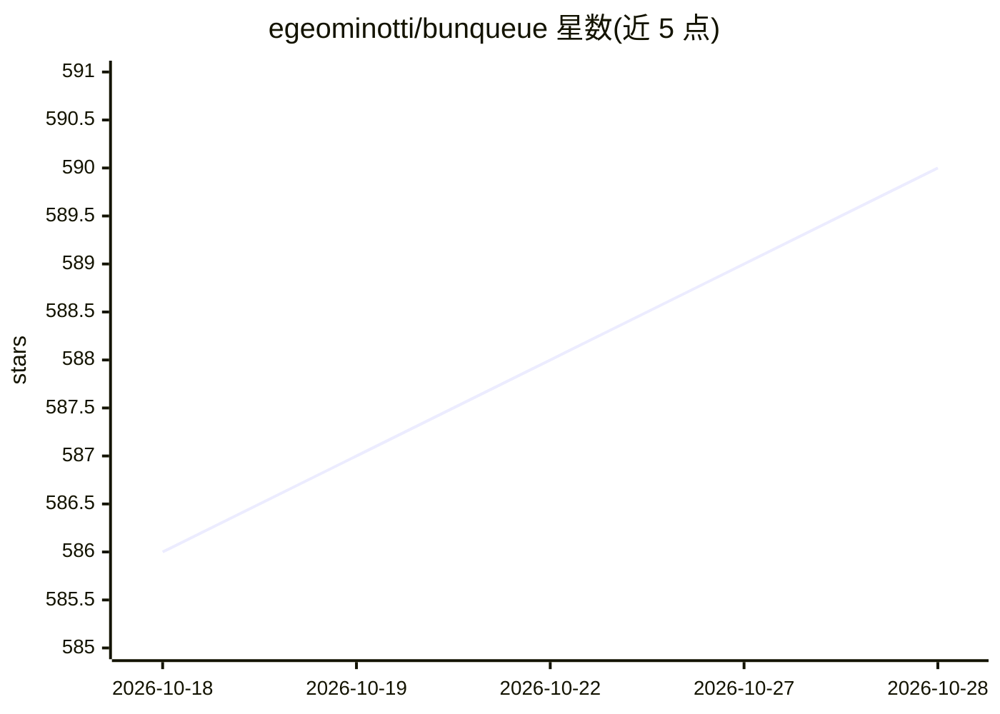

# egeominotti/bunqueue

⭐ 590 · TypeScript · MIT · 推送 2026-10-27 · [GitHub](https://github.com/egeominotti/bunqueue) · [官网](https://bunqueue.dev) · 个人维护

**面向 Bun 的任务队列：默认内存/SQLite，可扩到 PostgreSQL**

基于 Bun 运行时的作业队列库，提供嵌入式（进程内，内存或单文件 SQLite）与独立服务器（TCP）两种模式；含重试退避、优先级、定时任务、速率限制与死信队列，内置 MCP 服务器（79 个工具）供 AI agent 控制队列。API 与 BullMQ 及 BullMQ Pro 兼容（Queue/Worker/FlowProducer 等别名），无需 Redis；扩展时可用 PostgreSQL 15–18 多 broker，客户端覆盖 Node/Deno/Python/PHP/Go/Rust/Elixir。Docker 四种变体镜像与八平台独立可执行文件均已发布。

## 筛选速览

| 维度 | 判定 | 备注 |
|---|---|---|
| AI 角色 | `ai-enhanced` | 去掉 AI 部分产品仍成立 |
| 许可风险 | `permissive` | MIT |
| 部署形态 | `self-host` | docker 或自建部署 |
| 模型依赖 | — | README 未给出锁定关系 |
| 硬件要求 | — | 无带数字的原话,不猜 |
| 安装摩擦 | `low` | 无编译、无系统依赖或容器化 |
| 成熟度 | — | 结构信号不足 |

## 能力要点

- 零外部依赖：默认内存，配置 dataPath 即单文件 SQLite 持久化，无需 Redis
- BullMQ / BullMQ Pro 兼容 API（QueuePro/WorkerPro 别名、公平分组、原生批处理）
- 内置 MCP 服务器（79 个工具），AI agent 可直接控制队列
- PostgreSQL 15–18 多 broker 模式：数据库权威声明、租约隔离、共享限流与故障转移

## 适用场景

- 在 Bun 应用内嵌作业队列处理重试、定时任务与死信队列
- 为 AI agent 提供可调度的后台任务基础设施
- 不想运维 Redis 的团队从 BullMQ 迁移队列系统

## 场景标签

`工作流自动化` · 领域:效率与自动化

## 证据(README 行号)

> L11:  High-performance job queue for Bun. Memory or one-file SQLite; PostgreSQL 15–18 multi-broker when you scale.
> L12:  DLQ, cron, SQLite S3 backups, and native MCP. Built for AI agents and automation. No Redis.

## 星数曲线

2026-10-18 586 → 2026-10-28 590（+4）

---
*卡片 v1 · prompt 1.4 · 生成 2026-10-21 · 置信度 mid · 依据 README sha `b6c7661259b3` · [字段定义](../../DATASET.md)*
