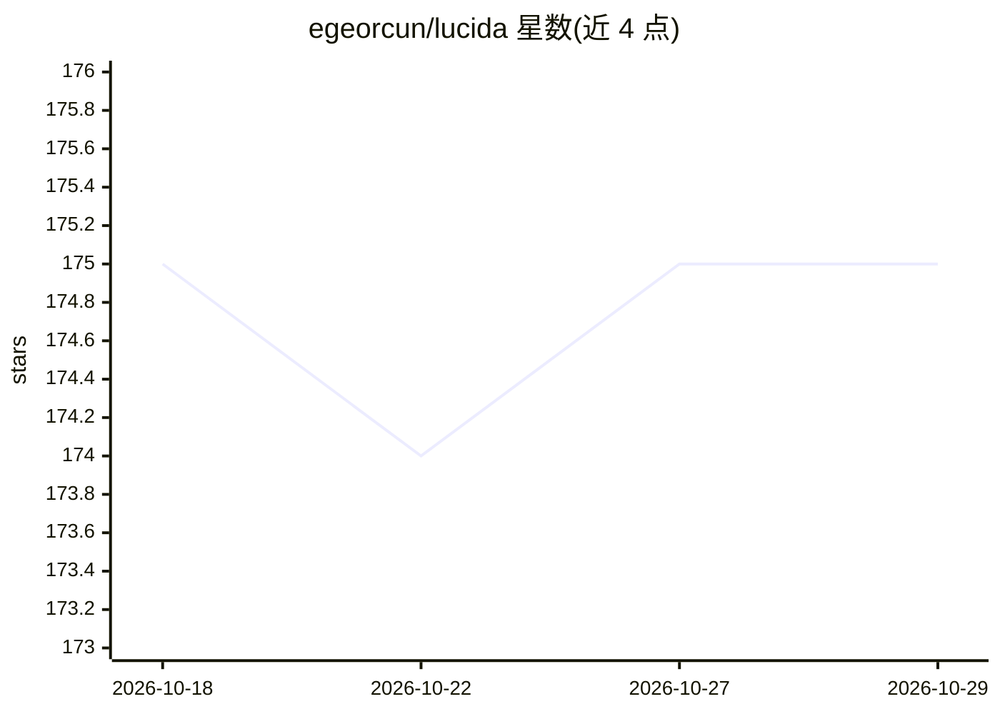

# egeorcun/lucida

⭐ 175 · Python · MIT · 推送 2026-08-05 · [GitHub](https://github.com/egeorcun/lucida) · [官网](https://huggingface.co/egeorcun/lucida) · 个人维护

**面向玻璃/迷彩/文字等难例的 BiRefNet 背景去除模型**

Lucida 是基于 BiRefNet_HR 微调（MIT）的图像抠图/背景去除模型，权重托管于 Hugging Face，针对半透明物体、迷彩主体、带软阴影的文字标志、辉光特效、线稿插画与印刷设计等通用背景去除器易失败的场景训练，使用 52,882 对图像（v7 起 10 类）。提供 transformers 加载、CLI（uv run bgr remove）、FastAPI HTTP 服务、ComfyUI 集成与 Docker 文档。需 Python>=3.12，从源码安装。README 同时公开自建基准（203 图 9 类 MAE）中的落后项，部分训练数据为 research-only 许可，商用需自行评估。

## 筛选速览

| 维度 | 判定 | 备注 |
|---|---|---|
| AI 角色 | `ai-native` | 本体是模型或模型工具 |
| 许可风险 | `permissive` | MIT |
| 部署形态 | `library` | 以包/库形式分发 |
| 模型依赖 | — | README 未给出锁定关系 |
| 硬件要求 | — | 无带数字的原话,不猜 |
| 安装摩擦 | `low` | 无编译、无系统依赖或容器化 |
| 成熟度 | — | 结构信号不足 |

## 能力要点

- BiRefNet_HR 微调，专攻半透明/迷彩/文字/辉光/插画/印刷设计等难例抠图
- 提供 transformers 加载、CLI、FastAPI 服务与 ComfyUI 官方模型库分发
- 自建 203 图 9 类基准，README 同时列出胜出与落后类别
- v8-v13 采用背景纯度铰链损失与 checkpoint soup，公开发布权重为 v7

## 适用场景

- 去除玻璃器皿、迷彩主体等半透明或与背景融合物体的背景
- 保留带软阴影的标志文字与辉光特效的透明通道
- 在 ComfyUI 工作流或 HTTP 服务中批量做背景去除

## 场景标签

`图像视频处理` · 领域:感知与多模态

## 证据(README 行号)

> L10: Lucida is a BiRefNet-based image matting model fine-tuned
> L94: Weights: **huggingface.co/egeorcun/lucida** — BiRefNet

## 星数曲线

2026-10-18 175 → 2026-10-29 175（+0）

---
*卡片 v1 · prompt 1.4 · 生成 2026-10-22 · 置信度 high · 依据 README sha `0654ac1e7ee1` · [字段定义](../../DATASET.md)*
