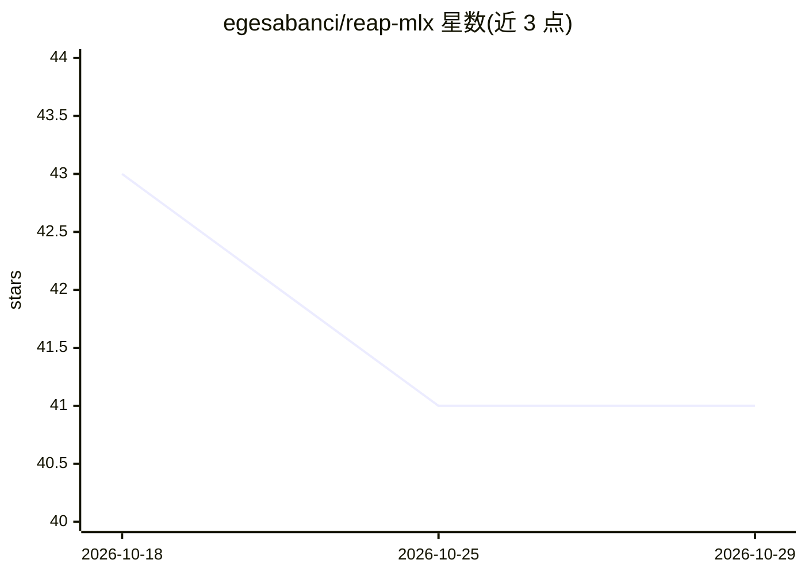

# egesabanci/reap-mlx

⭐ 41 · Python · MIT · 推送 2026-10-26 · [GitHub](https://github.com/egesabanci/reap-mlx) · 个人维护

**Apple Silicon 上对 MLX-LM MoE 模型做 REAP 专家剪枝的 Python 工具**

基于 mlx 与 mlx-lm 的 MoE 模型专家剪枝实现：加载 MLX-LM 模型，在校准数据上收集专家路由激活统计，按 9 种显著性方法排序并就地剪除低显著性专家，经 mlx_lm.save 保存后重载验证并可运行生成冒烟测试，每次运行输出 validation-metrics.json 结构化遥测。仅支持 Apple Silicon macOS 与 Python 3.12/3.13，支持 LFM2.5、Qwen2/3-MoE、OLMoE、Mixtral、PhiMoE 等适配器，路由不同的 DeepSeek、GLM4-MoE、MiniMax 会被拒绝。通过 uv 以源码方式安装并以 CLI 运行。

## 筛选速览

| 维度 | 判定 | 备注 |
|---|---|---|
| AI 角色 | `ai-ecosystem` | LLM/agent 周边工具 |
| 许可风险 | `permissive` | MIT |
| 部署形态 | `None` |  |
| 模型依赖 | — | README 未给出锁定关系 |
| 硬件要求 | — | 无带数字的原话,不猜 |
| 安装摩擦 | `medium` | 含编译或系统依赖之一 |
| 成熟度 | — | 结构信号不足 |

## 能力要点

- 9 种专家显著性剪枝方法（reap/expert_frequency/ean_sum 等）
- 校准→观察→剪枝→保存→重载验证的线性流程与生成冒烟测试
- 每次运行输出含计时、内存采样、吞吐与剪枝决策的 validation-metrics.json
- 模型族差异隔离在 src/reap/model_adapters.py 适配器中

## 适用场景

- 在 Mac 上本地压缩 MLX-LM MoE 模型以减小体积
- 对比不同剪枝方法与压缩比的 NLL 与运行成本
- 为 MLX 生态实验 MoE 剪枝而无需 CUDA/PyTorch/vLLM 环境

## 场景标签

`模型量化` · 领域:训练与推理

## 证据(README 行号)

> L20: REAP MLX applies Router-weighted Expert Activation Pruning (REAP) to
> L26: Use it when you want local MoE pruning experiments on Apple Silicon without a

## 星数曲线

2026-10-18 43 → 2026-10-29 41（-2）

---
*卡片 v1 · prompt 1.4 · 生成 2026-10-25 · 置信度 high · 依据 README sha `e79543917d8b` · [字段定义](../../DATASET.md)*
