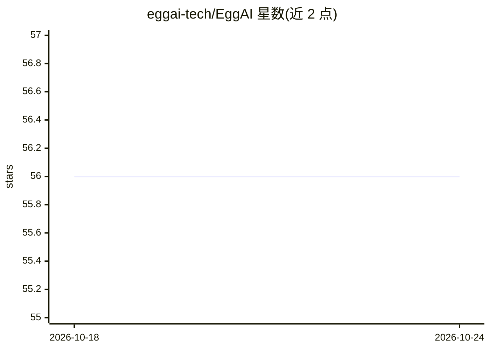

# eggai-tech/EggAI

⭐ 56 · Python · MIT · 推送 2026-10-23 · [GitHub](https://github.com/eggai-tech/EggAI) · [官网](https://docs.egg-ai.com/) · 组织维护

**面向企业的异步优先多智能体元框架与Python SDK**

EggAI 是构建企业级多智能体系统的 Python 元框架，采用异步优先、分布式、可组合与框架无关的设计。SDK 提供 Agent 与 Channel 组件：Agent 处理事件订阅、长流程编排与外部系统（LLM、API）通信；Channel 抽象 Kafka 生产者/消费者实现事件发布订阅。提供 CLI 生成项目脚手架，示例覆盖 DSPy、LangChain、LiteLLM、LlamaIndex 等框架集成，并附带一个多智能体保险支持系统演示（计费、理赔、RAG 检索、路由）。通过 pip 安装，MIT 许可，支持跨语言 Kafka 库互操作。

## 筛选速览

| 维度 | 判定 | 备注 |
|---|---|---|
| AI 角色 | `ai-ecosystem` | LLM/agent 周边工具 |
| 许可风险 | `permissive` | MIT |
| 部署形态 | `library` | 以包/库形式分发 |
| 模型依赖 | — | README 未给出锁定关系 |
| 硬件要求 | — | 无带数字的原话,不猜 |
| 安装摩擦 | `low` | 无编译、无系统依赖或容器化 |
| 成熟度 | — | 结构信号不足 |

## 能力要点

- Agent/Channel 组件：事件订阅、工作流编排、Kafka 生命周期管理
- CLI 一键生成含 agent、控制台与配置的完整项目
- 示例覆盖 DSPy/LangChain/LiteLLM/LlamaIndex 集成与 LLM-as-a-Judge 评测
- 多智能体保险支持系统演示（计费/理赔/RAG/智能路由）

## 适用场景

- 搭建事件驱动的企业多智能体系统
- 用 CLI 快速初始化多智能体项目结构
- 在 Kafka 之上实现跨语言 agent 通信
- 参考示例集成 LangChain/DSPy 等框架与 guardrails 防护

## 场景标签

`Agent 框架` `多智能体` · 领域:Agent 开发

## 证据(README 行号)

> L13: `EggAI Multi-Agent Meta Framework` makes it easy to build enterprise-grade multi-agent systems with quality-control
> L15: - EggAI SDK: A lightweight abstraction layer for building agents and enabling agent-to-agent communication.
> L130: **EggAI SDK** includes components like `Agent` and `Channel` for decoupled communication in multi-agent systems. I

## 星数曲线

2026-10-18 56 → 2026-10-24 56（+0）

---
*卡片 v1 · prompt 1.4 · 生成 2026-10-24 · 置信度 high · 依据 README sha `5bf79fc5c249` · [字段定义](../../DATASET.md)*
