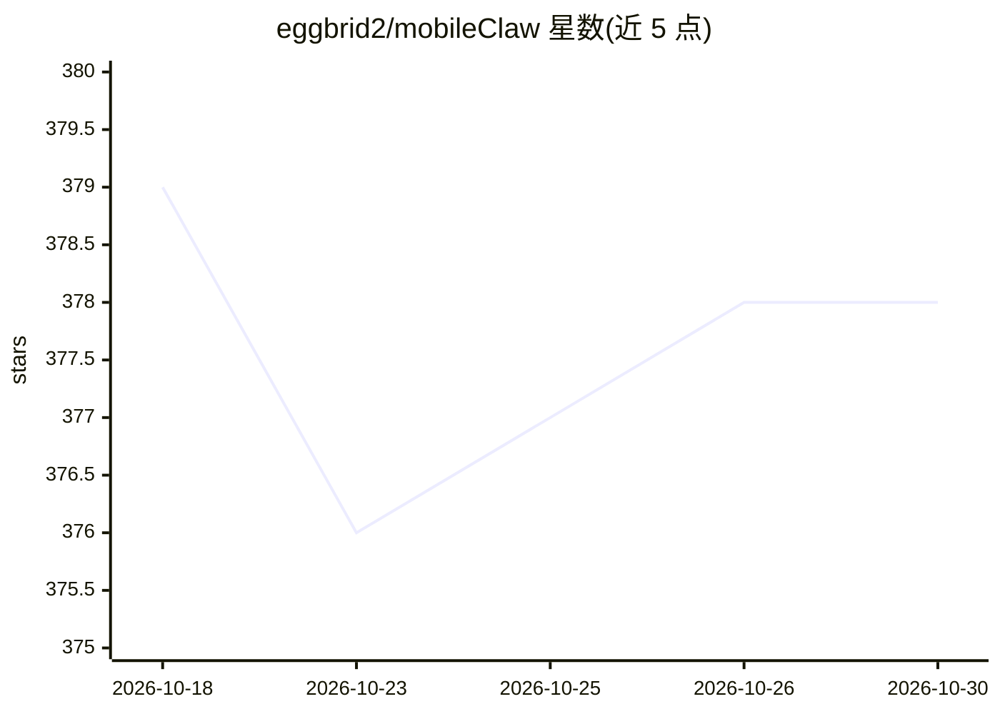

# eggbrid2/mobileClaw

⭐ 378 · Kotlin · NOASSERTION · 推送 2026-07-11 · [GitHub](https://github.com/eggbrid2/mobileClaw) · 个人维护 · 中文 README

**把安卓手机变成多 AI 角色竞技场的 agent 运行时应用**

Android 端 AI agent 运行时与实验应用：本版本核心是多 agent 群组竞技玩法——创建房间、为不同 AI 角色分别配置网关和模型，由系统主持人推进发言、投票、隐藏行动与淘汰流程，用于观察模型间的推理、博弈与暴露差异。底层还包含手机控制 agent、记忆、本地/云端模型路由、MiniAPP、技能工具、VPN 辅助与桌面 Codex 桥接。以 Kotlin/Compose 构建，需从源码用脚本编译 APK，无现成桌面版；更新分发走 Pgyer。

## 筛选速览

| 维度 | 判定 | 备注 |
|---|---|---|
| AI 角色 | `ai-native` | 本体是模型或模型工具 |
| 许可风险 | `none` | NOASSERTION |
| 部署形态 | `None` |  |
| 模型依赖 | — | README 未给出锁定关系 |
| 硬件要求 | — | 无带数字的原话,不猜 |
| 安装摩擦 | `low` | 无编译、无系统依赖或容器化 |
| 成熟度 | — | 结构信号不足 |

## 能力要点

- 多 AI 角色同房间的群组竞技：发言、投票、隐藏行动、淘汰与席位锁定
- 每个角色可选用用户配置的不同网关与模型
- 包含手机控制 agent、模型路由、MiniAPP、技能工具与桌面 Codex 桥接
- Kotlin/Jetpack Compose 实现，提供脚本化构建与 Pgyer 发布流程

## 适用场景

- 在手机上观看不同模型在社交博弈中的对抗与表现差异
- 组织 traitor-hunt、辩论房或自定义淘汰类多 agent 游戏
- 把手机作为 AI agent 实验场，运行技能与 MiniAPP

## 场景标签

`多智能体` `GUI 自动化` · 领域:Agent 开发

## 证据(README 行号)

> L7: MobileClaw is an Android AI agent lab. This release is about one thing first:
> L23: Create a room, seat several AI roles, let each role use a different configured

## 星数曲线

2026-10-18 379 → 2026-10-30 378（-1）

---
*卡片 v1 · prompt 1.4 · 生成 2026-10-21 · 置信度 high · 依据 README sha `87081c24f655` · [字段定义](../../DATASET.md)*
