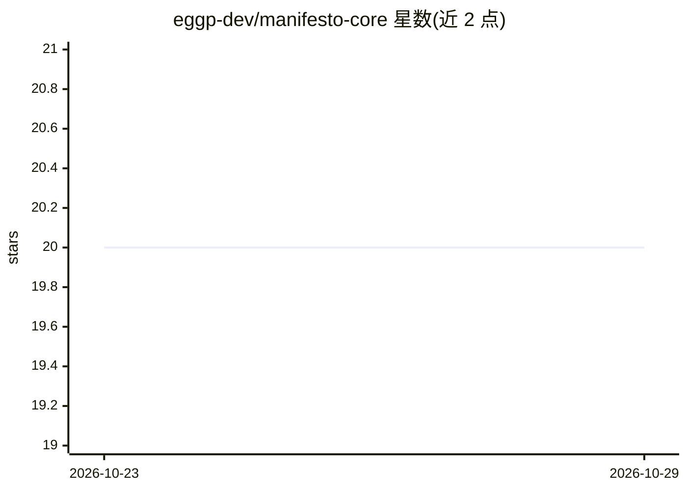

# eggp-dev/manifesto-core

⭐ 20 · TypeScript · MIT · 推送 2026-10-26 · [GitHub](https://github.com/eggp-dev/manifesto-core) · [官网](https://manifesto-ai.dev) · 个人维护

**声明式领域状态语义层：为应用与 agent 提供确定性状态迁移**

以 MEL 语言声明领域迁移规则，运行时从 schema、snapshot、intent 与 context 计算语义状态迁移，宿主执行声明的效果并收敛到下一个 Snapshot。SDK 是主要运行时表面：激活领域、提交类型化 action、观察 snapshot，使 UI、后端路由与 agent 共享同一状态契约。Lineage 与 Governance 为可选协议扩展，按需引入历史、审批、策略等能力。README 明确声明它不是状态管理库、不是 AI 框架、不是数据库/ORM、不是工作流引擎。需 Node.js >= 24，通过 npm 安装。

## 筛选速览

| 维度 | 判定 | 备注 |
|---|---|---|
| AI 角色 | `ai-ecosystem` | LLM/agent 周边工具 |
| 许可风险 | `permissive` | MIT |
| 部署形态 | `library` | 以包/库形式分发 |
| 模型依赖 | — | README 未给出锁定关系 |
| 硬件要求 | — | 无带数字的原话,不猜 |
| 安装摩擦 | `low` | 无编译、无系统依赖或容器化 |
| 成熟度 | — | 结构信号不足 |

## 能力要点

- MEL 声明式语言描述领域迁移规则
- UI、后端与 agent 共享同一确定性状态契约
- Lineage/Governance 可选扩展（历史、恢复、审批、策略、委托）
- 提供可选 CLI（npx @manifesto-ai/cli init）与编译器插件

## 适用场景

- 让 agent 与 UI 通过同一类型化 action 接口操作应用状态
- 需要可审计状态迁移（历史、审批、回滚）的产品
- 为 agent 工具回路提供确定性的领域状态运行时

## 场景标签

 · 领域:软件开发框架/agent 状态管理

## 证据(README 行号)

> L9: Most applications use the SDK as the public runtime surface: activate a domain,
> L82: 9. Go deeper on agent-only tool loops: AI Agents
> L99: - Not an AI framework

## 星数曲线

2026-10-23 20 → 2026-10-29 20（+0）

---
*卡片 v1 · prompt 1.4 · 生成 2026-10-28 · 置信度 mid · 依据 README sha `72c84cdb225b` · [字段定义](../../DATASET.md)*
