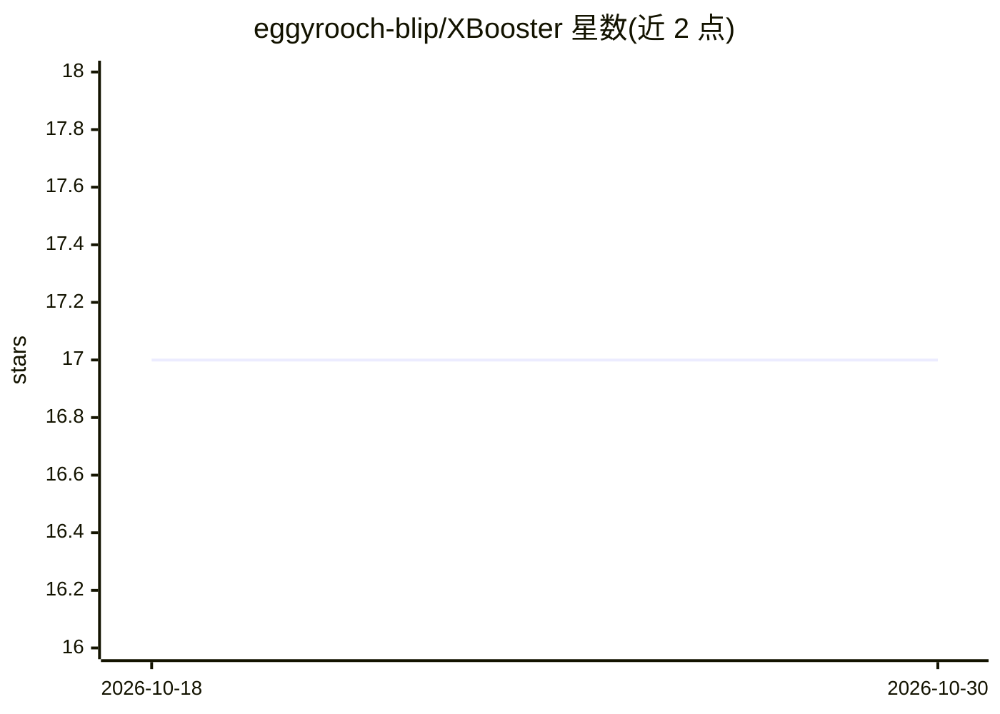

# eggyrooch-blip/XBooster

⭐ 17 · JavaScript · 推送 2026-01-21 · [GitHub](https://github.com/eggyrooch-blip/XBooster) · [官网](https://x.com/eggyrooch) · 个人维护 · 中文 README

**Chrome 扩展：在 X 平台批量生成 AI 评论并按潜力筛选帖子**

运行于 Chrome 的 Manifest V3 浏览器扩展，面向 X（Twitter）用户：读取帖子内容后调用 OpenAI 官方或兼容接口生成评论，支持情绪风格选择、批量回复（队列并发、自动续扫）、四维度 120 分制潜力指数筛选与硬过滤、回复后自动点赞、多语言翻译与自定义书签。AI 接口需用户自行配置 API Key，可配置多个代理站做负载均衡；仅在 x.com 与 pro.x.com 工作。通过开发者模式加载解压源码安装，写作与翻译功能处于灰度测试。

## 筛选速览

| 维度 | 判定 | 备注 |
|---|---|---|
| AI 角色 | `ai-native` | 本体是模型或模型工具 |
| 许可风险 | `none` | — |
| 部署形态 | `None` |  |
| 模型依赖 | — | README 未给出锁定关系 |
| 硬件要求 | — | 无带数字的原话,不猜 |
| 安装摩擦 | `low` | 无编译、无系统依赖或容器化 |
| 成熟度 | `idea` | |

## 能力要点

- 调用 OpenAI 官方或兼容接口生成个性化评论，支持 8 种情绪风格
- 批量回复：队列并发处理、自动续扫新帖
- 四维度 120 分制潜力指数筛选（时间/竞争/流量/内容）与硬过滤红线
- 多代理站负载均衡与自定义提示词模板（变量替换）

## 适用场景

- 在 X 时间线或搜索页批量生成并填入评论
- 按潜力指数筛选高价值帖子决定回复优先级
- 将帖子内容翻译为指定语言

## 场景标签

`AI 写作` · 领域:内容生成

## 证据(README 行号)

> L29: - **单条回复**：点击扩展图标，自动读取当前帖子内容，基于 AI 生成个性化评论
> L74: - **AI 接口选择**：支持 OpenAI 官方接口或自定义兼容接口

## 星数曲线

2026-10-18 17 → 2026-10-30 17（+0）

---
*卡片 v1 · prompt 1.4 · 生成 2026-10-29 · 置信度 high · 依据 README sha `f475d36b1bda` · [字段定义](../../DATASET.md)*
