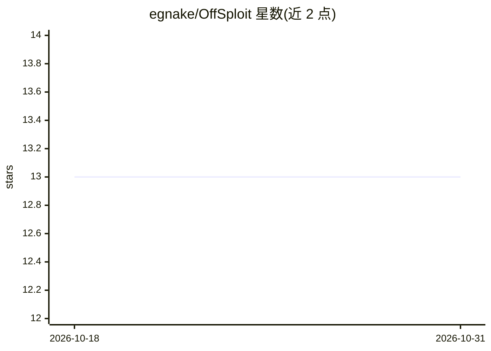

# egnake/OffSploit

⭐ 13 · Python · MIT · 推送 2026-06-14 · [GitHub](https://github.com/egnake/OffSploit) · 个人维护

**本地 LLM 驱动的自主红队渗透框架：检索改写 Exploit 并编译**

面向授权渗透测试与红队作业的自主化框架：读取 Nmap XML 与 BloodHound JSON 融合计算多阶段攻击路径，用 ChromaDB RAG（nomic-embed-text）语义检索 Exploit-DB 归档，再以本地 LLM（如 qwen2.5-coder）改写 exploit 代码适配目标；生成代码在隔离 Docker 沙箱内编译，出错时将 stderr 回喂 LLM 自修复重编。含多代理 OPSEC 审查、多态混淆引擎（basic/advanced/paranoid 三级）与 Flask Web 面板。需 Python 3.10+、Docker、Ollama、Nmap，全程离线运行，限授权用途。

## 筛选速览

| 维度 | 判定 | 备注 |
|---|---|---|
| AI 角色 | `ai-enhanced` | 去掉 AI 部分产品仍成立 |
| 许可风险 | `permissive` | MIT |
| 部署形态 | `self-host` | docker 或自建部署 |
| 模型依赖 | local-ok | 支持本地模型 |
| 硬件要求 | — | 无带数字的原话,不猜 |
| 安装摩擦 | `low` | 无编译、无系统依赖或容器化 |
| 成熟度 | — | 结构信号不足 |

## 能力要点

- RAG 检索 Exploit-DB + 本地 LLM 改写 exploit 适配目标环境
- Docker 沙箱内自修复编译循环：stderr 回喂 LLM 直至产出可用产物
- ExploitAgent/OPSECAgent 多代理反馈环，编译前 AST 级 OPSEC 检查
- Nmap+BloodHound 融合计算多阶段攻击路径与自主横向移动建议

## 适用场景

- 授权红队作业中根据扫描结果自动检索并适配公开 exploit
- 隔离网络环境下离线执行渗透测试流程
- 对生成的代码做多态混淆以绕过 AV/EDR 检测

## 场景标签

`网络安全` `编码 Agent` · 领域:编码与开发

## 证据(README 行号)

> L11: OffSploit is an advanced, autonomous Red Team and penetration testing framework designed to transcend traditional v
> L20: Instead of relying on static, pre-compiled exploits, OffSploit dynamically reads Nmap XML outputs, semantically sea

## 星数曲线

2026-10-18 13 → 2026-10-31 13（+0）

---
*卡片 v1 · prompt 1.4 · 生成 2026-10-31 · 置信度 high · 依据 README sha `f794a678d744` · [字段定义](../../DATASET.md)*
