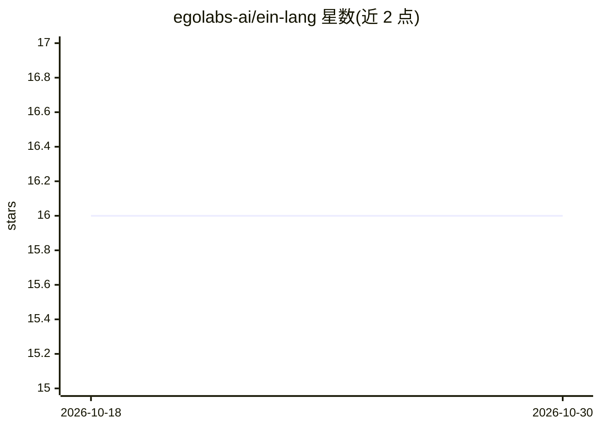

# egolabs-ai/ein-lang

⭐ 16 · Rust · MIT · 推送 2026-05-11 · [GitHub](https://github.com/egolabs-ai/ein-lang) · 组织维护

**将爱因斯坦张量记法与 Datalog 逻辑编程统一的张量逻辑语言**

基于 Rust/Candle 实现的编程语言与 REPL：用同一种爱因斯坦记法语法书写张量运算、可训练神经网络（@param 参数、:train 训练、:generate 文本生成）、Datalog 风格逻辑规则与知识图谱嵌入训练（DistMult、MRR/Hits@K 评估）。理论依据为 Pedro Domingos 的 Tensor Logic 论文（arXiv:2510.12269），核心是 Datalog 规则与张量收缩等价，使规则权重可经梯度下降学习。需 Rust 1.75+ 从源码编译，支持 Metal/CUDA 特性构建；示例含 6 层 10.7M 参数 GPT 与 FB15k-237 基准。

## 筛选速览

| 维度 | 判定 | 备注 |
|---|---|---|
| AI 角色 | `ai-native` | 本体是模型或模型工具 |
| 许可风险 | `permissive` | MIT |
| 部署形态 | `None` |  |
| 模型依赖 | — | README 未给出锁定关系 |
| 硬件要求 | — | 无带数字的原话,不猜 |
| 安装摩擦 | `high` | 编译与系统依赖俱全 |
| 成熟度 | — | 结构信号不足 |

## 能力要点

- 同一语法表达 einsum、MLP/注意力与逻辑规则组合
- Datalog 规则对应张量收缩，规则权重可微学习
- REPL 支持：train/:generate/:load_kb/:train_kb/:eval_kb 等命令
- 支持 Metal（Apple Silicon）与 CUDA 特性编译

## 适用场景

- 在同一语言中编写神经网络与符号推理程序
- 训练知识图谱嵌入并做链接预测评估
- 研究神经符号统一表示（可微逻辑推理）

## 场景标签

`知识图谱` · 领域:知识与检索

## 证据(README 行号)

> L5: Ein combines Einstein notation tensor operations with Datalog-style logic programming in a single, elegant syntax. W
> L59: :train Loss epochs=1000 lr=0.001 optimizer=adamw

## 星数曲线

2026-10-18 16 → 2026-10-30 16（+0）

---
*卡片 v1 · prompt 1.4 · 生成 2026-10-30 · 置信度 high · 依据 README sha `39765be765c7` · [字段定义](../../DATASET.md)*
