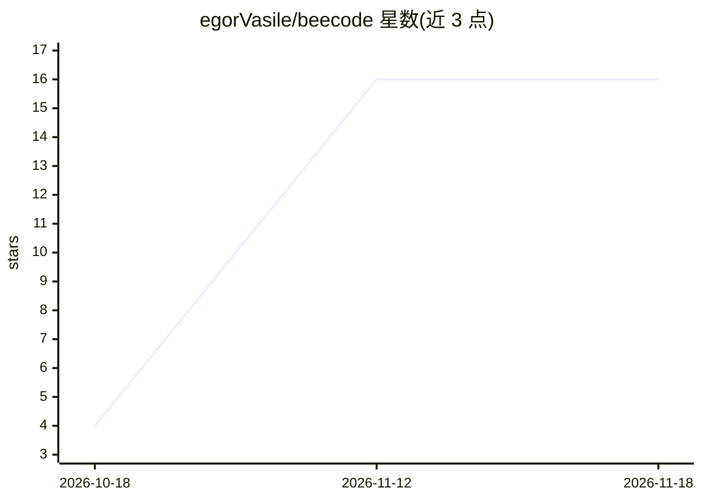

# egorVasile/beecode

⭐ 16 · Python · GPL-3.0 · 推送 2026-11-15 · [GitHub](https://github.com/egorVasile/beecode) · 个人维护 · 中文 README

**免费终端 AI 编程代理：无需 API key 即可读写文件执行命令**

运行于终端与 Windows 桌面的 AI 编程代理：用自然语言描述任务，代理读取/编辑文件、搜索项目、执行命令并报告结果，工具权限可配置。模型接入支持 OpenAI 兼容提供方及内置提供方（描述中标注 g4f、无需 API key），支持 skills、plugins 与 MCP 扩展，桌面端含 skill 查找安装与界面定制功能。终端版需 Python 3.10+，经 pip 从 git 仓库安装；桌面版提供 Windows 安装包，首次启动自动创建 Python 环境并可能下载依赖。配置与对话历史保存在本地。GPL-3.0-or-later 许可。

## 筛选速览

| 维度 | 判定 | 备注 |
|---|---|---|
| AI 角色 | `ai-native` | 本体是模型或模型工具 |
| 许可风险 | `viral` | GPL-3.0 |
| 部署形态 | `desktop` | 安装包/桌面程序 |
| 模型依赖 | — | README 未给出锁定关系 |
| 硬件要求 | — | 无带数字的原话,不猜 |
| 安装摩擦 | `low` | 无编译、无系统依赖或容器化 |
| 成熟度 | — | 结构信号不足 |

## 能力要点

- 自然语言驱动的文件读写、项目搜索与命令执行，工具权限可配置
- 支持 OpenAI 兼容提供方与内置提供方，无需 API key（g4f）
- skills、plugins、MCP 服务器扩展机制
- 桌面端按项目组织会话与子代理，可查看工具调用明细

## 适用场景

- 在终端用自然语言让代理完成代码修改与命令执行
- 通过 MCP、插件和技能扩展代理能力
- 在 Windows 桌面按项目管理多个代理会话

## 场景标签

`编码 Agent` · 领域:编码与开发

## 证据(README 行号)

> L3: BeeCode is an AI coding agent for the terminal and Windows desktop. Describe a task in plain language and let the ag
> L12: - **Choose your models:** connect an OpenAI-compatible provider or use the available built-in providers. Supported 

## 星数曲线

2026-10-18 4 → 2026-11-18 16（+12）

---
*卡片 v1 · prompt 1.4 · 生成 2026-11-18 · 置信度 high · 依据 README sha `13a3d9c39cac` · [字段定义](../../DATASET.md)*
