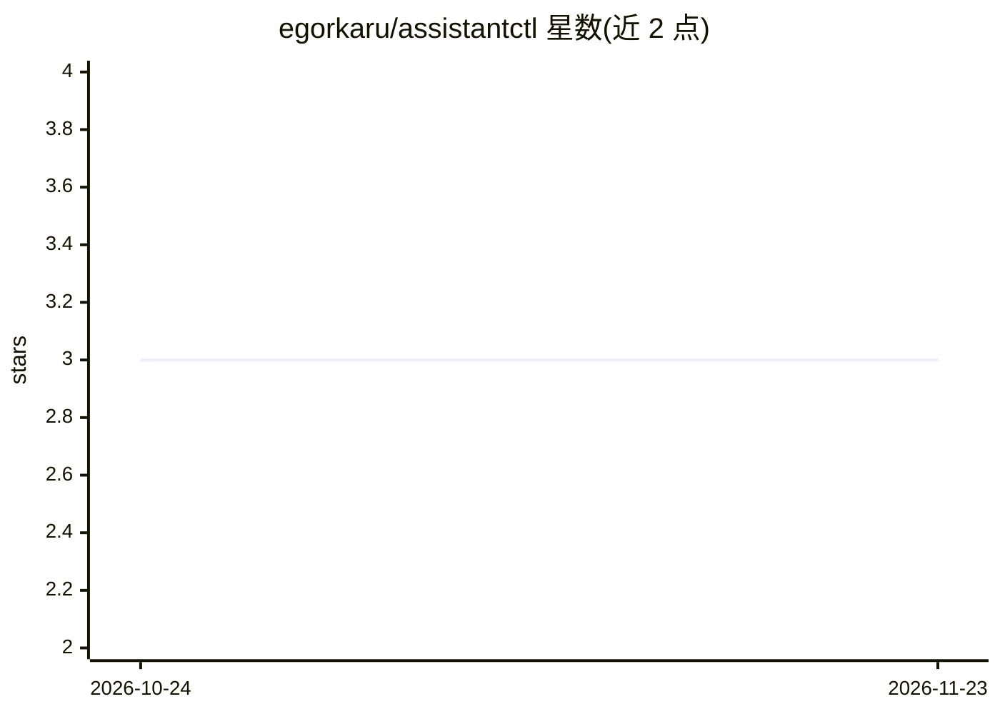

# egorkaru/assistantctl

⭐ 3 · Swift · MIT · 推送 2026-10-16 · [GitHub](https://github.com/egorkaru/assistantctl) · 个人维护

**给 AI agent 提供本地消息缓存的只读 CLI 与 MCP 服务器**

将 Telegram、Gmail 和 Microsoft Mail 导入本地 SQLite 缓存，通过 CLI 与 MCP 服务器向人和 agent 提供缓存的只读读取。支持 Gmail OAuth 登录与同步、Telegram 手机号/二维码登录、Microsoft Mail OAuth 登录；MCP 服务器支持 stdio 与 Streamable HTTP 两种传输（实现 MCP 2025-11-25），HTTP 模式提供 Bearer token 鉴权。仅支持 macOS 15+，以 GitHub release 归档分发，另支持源码构建。

## 筛选速览

| 维度 | 判定 | 备注 |
|---|---|---|
| AI 角色 | `ai-ecosystem` | LLM/agent 周边工具 |
| 许可风险 | `permissive` | MIT |
| 部署形态 | `None` |  |
| 模型依赖 | — | README 未给出锁定关系 |
| 硬件要求 | — | 无带数字的原话,不猜 |
| 安装摩擦 | `low` | 无编译、无系统依赖或容器化 |
| 成熟度 | — | 结构信号不足 |

## 能力要点

- Telegram/Gmail/Microsoft Mail 导入本地 SQLite 缓存，只读访问
- CLI 与 MCP 服务器双入口，支持 stdio 与 Streamable HTTP 传输
- MCP HTTP 端点带 Bearer token 鉴权
- 以 macOS universal 二进制归档发布，支持源码构建

## 适用场景

- 让本地 AI agent 通过 MCP 检索我的 Telegram 和邮件消息
- 在本地统一缓存并查询多个邮箱账户的消息
- 将消息作为知识库供 LLM 工具链搜索

## 场景标签

`Agent 记忆` · 领域:Agent 开发

## 证据(README 行号)

> L3: `assistantctl` imports Telegram, Gmail, and Microsoft Mail into a local SQLite cache. The CLI and MCP server let peo
> L31: For a local agent, launch `assistantctl mcp stdio` as its MCP command. For Streamable HTTP, run `assistantctl mcp s

## 星数曲线

2026-10-24 3 → 2026-11-23 3（+0）

---
*卡片 v1 · prompt 1.4 · 生成 2026-11-22 · 置信度 high · 依据 README sha `9b0e518301a0` · [字段定义](../../DATASET.md)*
