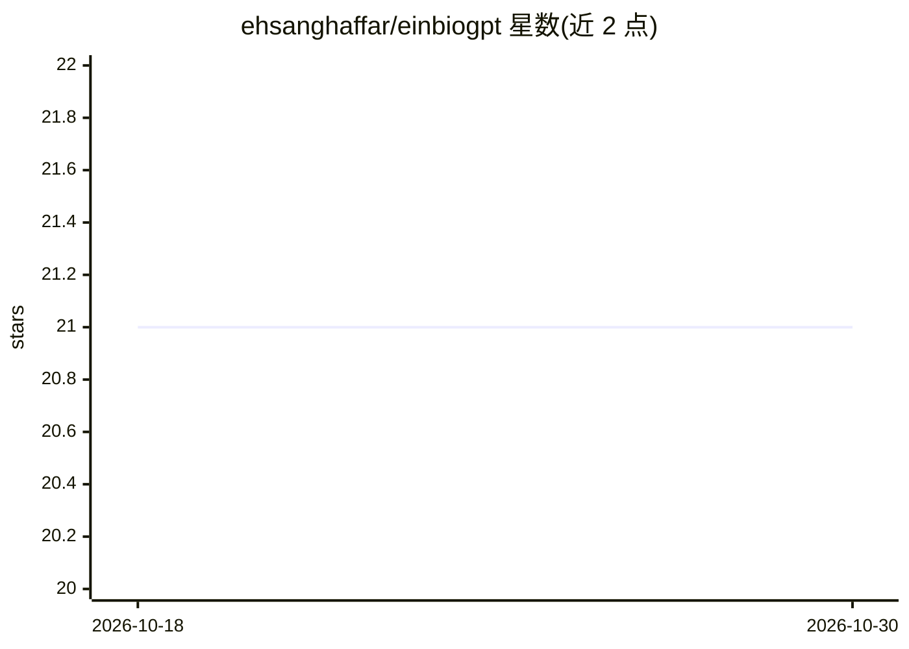

# ehsanghaffar/einbiogpt

⭐ 21 · TypeScript · MIT · 推送 2026-10-12 · [GitHub](https://github.com/ehsanghaffar/einbiogpt) · [官网](https://bio.eindev.ir/) · 个人维护

**面向社媒创作者的 AI 个人简介/内容生成 Web 应用**

基于 Next.js 14、TypeScript 与 Tailwind CSS 的 Web 应用，用 OpenAI、OpenRouter、Gemini 的模型及 LangChain 编排，为社媒管理者、求职者、小企业主等生成个性化简介、欢迎消息并优化既有内容；支持 Twitter/Instagram/LinkedIn/TikTok 等多平台与多种语气选项，提供实时流式对话迭代修改。内置 Upstash Redis 速率限制、RTL（波斯语）支持与 Vercel 部署说明。需 Node.js 18+，通过 git clone + yarn/npm 安装，配置对应 LLM 的 API key 运行，也提供 Docker 构建方式。

## 筛选速览

| 维度 | 判定 | 备注 |
|---|---|---|
| AI 角色 | `ai-native` | 本体是模型或模型工具 |
| 许可风险 | `permissive` | MIT |
| 部署形态 | `self-host` | docker 或自建部署 |
| 模型依赖 | locked-api |  |
| 硬件要求 | — | 无带数字的原话,不猜 |
| 安装摩擦 | `low` | 无编译、无系统依赖或容器化 |
| 成熟度 | — | 结构信号不足 |

## 能力要点

- 生成多平台社媒简介、欢迎消息与内容优化
- 支持 OpenAI / OpenRouter / Gemini 多 LLM 提供商切换
- SSE 流式实时对话迭代内容
- Upstash Redis 速率限制与波斯语 RTL 支持

## 适用场景

- 社媒管理者为不同平台批量生成简介变体
- 求职者撰写 LinkedIn 职业简介
- 内容创作者通过对话迭代优化文案

## 场景标签

`AI 写作` `聊天机器人` · 领域:对话与助手

## 证据(README 行号)

> L12: **Generate engaging, personalized social media bios, welcome messages, and improved content with AI-powered suggest
> L22: BioGPT is an intelligent web application that helps users create compelling social media bios, welcome messages, an

## 星数曲线

2026-10-18 21 → 2026-10-30 21（+0）

---
*卡片 v1 · prompt 1.4 · 生成 2026-10-28 · 置信度 high · 依据 README sha `e820bb25cac3` · [字段定义](../../DATASET.md)*
