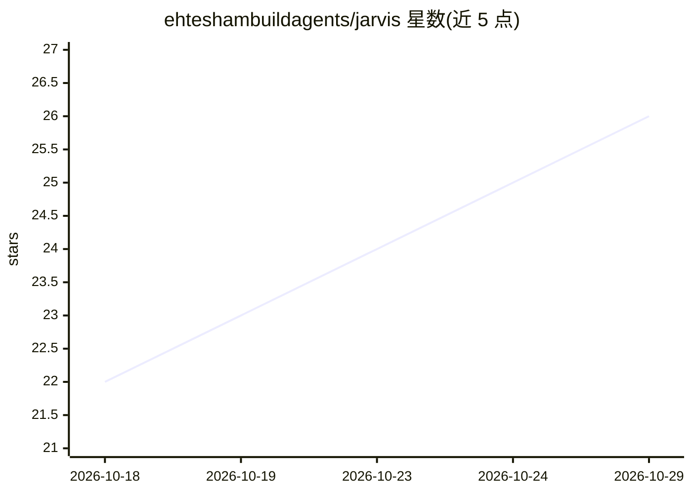

# ehteshambuildagents/jarvis

⭐ 26 · TypeScript · NOASSERTION · 推送 2026-09-26 · [GitHub](https://github.com/ehteshambuildagents/jarvis) · 个人维护

**语音驱动的浏览器个人助理，以 Claude Code 为大脑**

基于 adewaskar/jarvis 的分叉：浏览器端（React+Vite+Three.js+GLSL）呈现钢铁侠风格全息界面与语音交互，后端为单进程 Node 桥接，通过 Claude Agent SDK 以无头方式运行 Claude Code 作为大脑，复用其订阅登录、无需 API key。可调用 ~/.claude.json 中配置的各 MCP 服务器（搜索、生图、手机控制、浏览器操作等），并通过 MCP 工具控制自身界面。本分叉新增桥接仅绑定回环地址、Windows 支持、语音待机与无人值守模式；ElevenLabs 语音为可选增强。需 Claude Code 订阅、Node.js 20+ 与 Chrome/Edge。

## 筛选速览

| 维度 | 判定 | 备注 |
|---|---|---|
| AI 角色 | `ai-native` | 本体是模型或模型工具 |
| 许可风险 | `none` | NOASSERTION |
| 部署形态 | `library` | 以包/库形式分发 |
| 模型依赖 | locked-api |  |
| 硬件要求 | — | 无带数字的原话,不猜 |
| 安装摩擦 | `low` | 无编译、无系统依赖或容器化 |
| 成熟度 | — | 结构信号不足 |

## 能力要点

- 以 Claude Agent SDK 无头运行 Claude Code 作为大脑，复用现有订阅登录
- 本地能量 VAD 支持抢话（barge-in），两档转录自动选择（ElevenLabs Scribe / 浏览器语音识别）
- 可调用用户配置的全部 MCP 服务器（搜索/生图/手机/浏览器等）
- 通过 ui_* MCP 工具用语音控制界面主题、反应堆与特效

## 适用场景

- 对着浏览器说 'Hey Jarvis' 完成搜索、生图、读邮件等任务
- 让助理语音操控其自身的全息界面与显示面板
- 作为常驻后台语音助理运行（无人值守模式）

## 场景标签

`语音 Agent` `AI 助手` · 领域:对话与助手

## 证据(README 行号)

> L3: A browser voice assistant with an Iron Man holographic interface. Say
> L6: is a web page (React + Vite + Three.js + custom GLSL). The brain is Claude Code,
> L141: process (`bridge/server.mjs`) that runs the **Claude Agent SDK**

## 星数曲线

2026-10-18 22 → 2026-10-29 26（+4）

---
*卡片 v1 · prompt 1.4 · 生成 2026-10-27 · 置信度 high · 依据 README sha `7c43d8fb1a26` · [字段定义](../../DATASET.md)*
