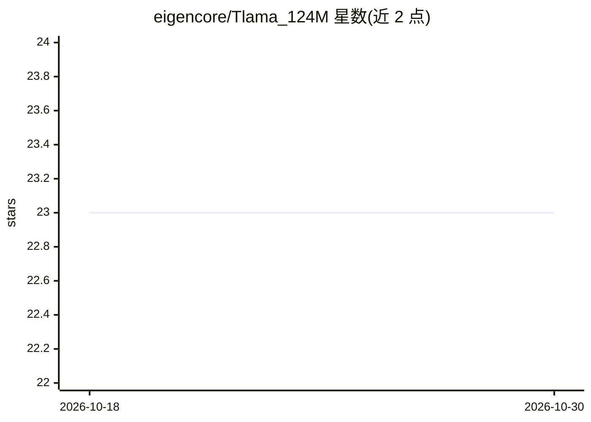

# eigencore/Tlama_124M

⭐ 23 · Python · Apache-2.0 · 推送 2026-05-16 · [GitHub](https://github.com/eigencore/Tlama_124M) · [官网](https://eigencore.org) · 组织维护

**面向资源受限硬件的 124M 参数 LLaMa 架构小型语言模型**

EigenCore 发布的 124M 参数语言模型，架构基于 LLaMa，训练数据为 edu_fineweb10B（FineWeb 子集，100 亿 token）。采用 Flash Attention、混合精度、梯度裁剪、Torch.compile、权重共享等优化，宣称可在消费级硬件（如 NVIDIA RTX 4060）上训练，训练基础设施为 8 张 A100。兼容 Hugging Face transformers，通过 AutoModel.from_pretrained 加载（需 trust_remote_code=True）。README 自述为开发起点，后续迭代计划改进精度与硬件效率。

## 筛选速览

| 维度 | 判定 | 备注 |
|---|---|---|
| AI 角色 | `ai-native` | 本体是模型或模型工具 |
| 许可风险 | `permissive` | Apache-2.0 |
| 部署形态 | `None` |  |
| 模型依赖 | — | README 未给出锁定关系 |
| 硬件要求 | — | 无带数字的原话,不猜 |
| 安装摩擦 | `low` | 无编译、无系统依赖或容器化 |
| 成熟度 | `idea` | |

## 能力要点

- 124M 参数 LLaMa 架构，edu_fineweb10B（10B token）训练
- Flash Attention / 混合精度 / 梯度累积 / Torch.compile 等优化
- 兼容 Hugging Face transformers 加载
- 宣称可在消费级 GPU（RTX 4060）上训练

## 适用场景

- 在显存有限的消费级硬件上运行或微调小型语言模型
- 作为语言建模实验与研究的小型基座模型
- 学习 LLaMa 架构小模型的优化训练流程

## 场景标签

 · 领域:自然语言处理/语言模型

## 证据(README 行号)

> L5: Tlama (124M) is a language model based on **LLaMa (127M)** optimized by **EigenCore**. It is designed for **computat
> L27: - **Model:** Based on LLaMa with **124M parameters**.

## 星数曲线

2026-10-18 23 → 2026-10-30 23（+0）

---
*卡片 v1 · prompt 1.4 · 生成 2026-10-27 · 置信度 high · 依据 README sha `de7817b19d74` · [字段定义](../../DATASET.md)*
