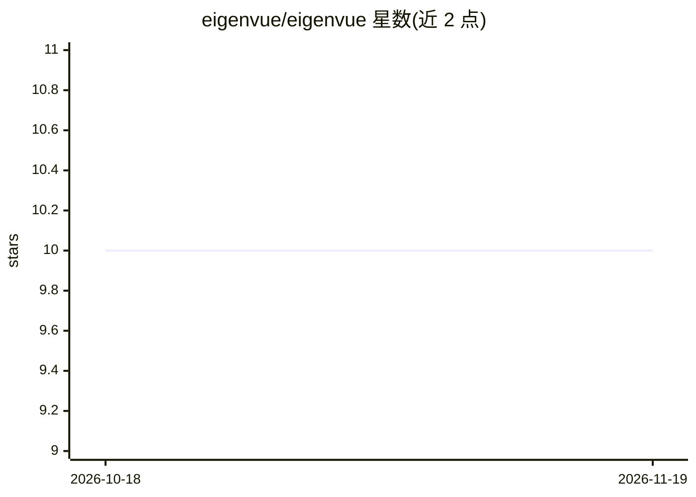

# eigenvue/eigenvue

⭐ 10 · TypeScript · MIT · 推送 2026-08-11 · [GitHub](https://github.com/eigenvue/eigenvue) · [官网](https://eigenvue.web.app) · 个人维护

**面向学习者的深度学习、生成式 AI 与量子算法交互式可视化教学平台**

Eigenvue 提供 27 个算法的逐步动画可视化，覆盖经典算法、深度学习、生成式 AI（BPE 分词、自注意力、Transformer 块等）与量子计算四个领域，每步配同步代码高亮（伪代码/Python/JavaScript）、概念讲解、常见误区与测验。可通过浏览器应用直接访问，或经 pip/npm 安装后在 Jupyter 与研究脚本中嵌入。算法以 TypeScript 和 Python 函数定义，双语言步骤序列一致性由 CI 强制；Web 端基于 Next.js，Python 包仅依赖 Flask。MIT 许可。

## 筛选速览

| 维度 | 判定 | 备注 |
|---|---|---|
| AI 角色 | `ai-knowledge` | 知识聚合/清单类 |
| 许可风险 | `permissive` | MIT |
| 部署形态 | `library` | 以包/库形式分发 |
| 模型依赖 | — | README 未给出锁定关系 |
| 硬件要求 | — | 无带数字的原话,不猜 |
| 安装摩擦 | `low` | 无编译、无系统依赖或容器化 |
| 成熟度 | — | 结构信号不足 |

## 能力要点

- 27 个算法的逐步可视化，含生成式 AI 与量子计算条目
- 浏览器应用与 pip/npm 双发行渠道，支持 Jupyter 嵌入
- TypeScript 与 Python 生成器输出一致步骤序列（CI 校验）
- 可视化状态可 URL 编码分享

## 适用场景

- 在学习注意力机制、反向传播等 AI 概念时逐步观察算法执行过程
- 在 Jupyter 教学笔记中嵌入交互式算法可视化
- 课堂上演示量子电路与 Grover 搜索等量子算法步骤

## 场景标签

`教程课程` · 领域:学习与行业

## 证据(README 行号)

> L3: **Interactive Dissection Platform for deep learning, generative AI, and quantum algorithms**
> L5: Interactive, step-by-step visualizations with synchronized code highlighting,
> L64: > **27 algorithms** with step-by-step animated visualizations, synchronized code highlighting (pseudocode, Python, 

## 星数曲线

2026-10-18 10 → 2026-11-19 10（+0）

---
*卡片 v1 · prompt 1.4 · 生成 2026-11-19 · 置信度 high · 依据 README sha `9746bd3ccb5a` · [字段定义](../../DATASET.md)*
