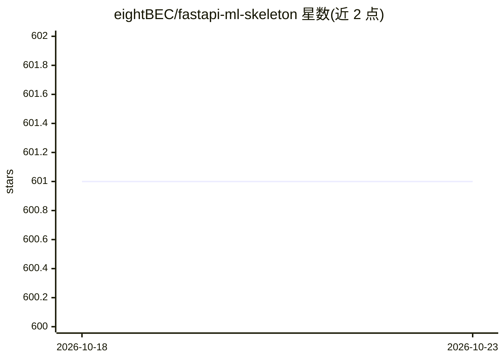

# eightBEC/fastapi-ml-skeleton

⭐ 601 · Python · Apache-2.0 · 推送 2026-01-08 · [GitHub](https://github.com/eightBEC/fastapi-ml-skeleton) · 个人维护

**FastAPI 机器学习模型服务脚手架，含房价预测示例**

基于 FastAPI 的机器学习模型服务骨架应用：提供生产就绪的 RESTful API 服务结构，代码经完整测试并预配置 tox、linting 脚本与测试脚本。内置一个房价预测回归模型作为示例，通过 uvicorn 启动后可在 localhost:8000/docs 交互式调用，API 使用 .env 中配置的 API_KEY 做鉴权。安装依赖 Poetry，要求 Python 3.11+。面向希望快速搭建模型服务项目的开发者。

## 筛选速览

| 维度 | 判定 | 备注 |
|---|---|---|
| AI 角色 | `ai-ecosystem` | LLM/agent 周边工具 |
| 许可风险 | `permissive` | Apache-2.0 |
| 部署形态 | `None` |  |
| 模型依赖 | — | README 未给出锁定关系 |
| 硬件要求 | — | 无带数字的原话,不猜 |
| 安装摩擦 | `low` | 无编译、无系统依赖或容器化 |
| 成熟度 | — | 结构信号不足 |

## 能力要点

- FastAPI 生产就绪的模型服务脚手架，代码完整测试
- 内置房价预测示例模型，可经 RESTful API 调用
- API_KEY 鉴权配置与 Swagger docs 交互调试
- 预配置 tox、isort/mypy/black/bandit 等 linting 与测试脚本

## 适用场景

- 快速启动一个新的机器学习模型 API 服务项目
- 在标准化代码结构上扩展自己的模型
- 运行内置房价预测示例学习模型服务流程

## 场景标签

`推理引擎` · 领域:训练与推理

## 证据(README 行号)

> L3: Serving machine learning models production-ready, fast, easy and secure powered by the great FastAPI by Sebastián Ra
> L7: To experiment and get a feeling on how to use this skeleton, a sample regression model for house price prediction is

## 星数曲线

2026-10-18 601 → 2026-10-23 601（+0）

---
*卡片 v1 · prompt 1.4 · 生成 2026-10-21 · 置信度 high · 依据 README sha `e8c4a855bc2c` · [字段定义](../../DATASET.md)*
