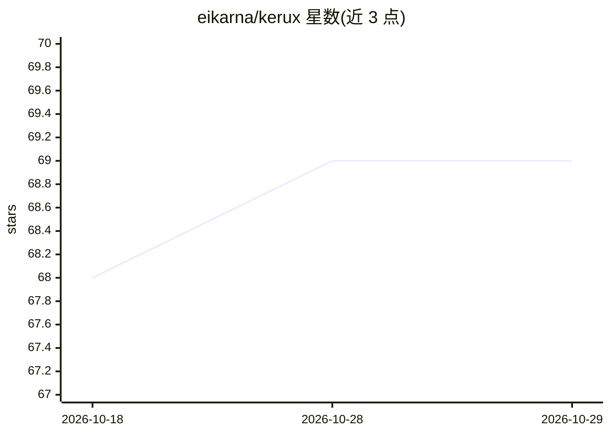

# eikarna/kerux

⭐ 69 · Rust · MIT · 推送 2026-08-31 · [GitHub](https://github.com/eikarna/kerux) · [官网](http://kerux.eikarna.dev/) · 个人维护

**自包含 Rust AI agent 运行时，用于 LLM 驱动的工具执行**

用 Rust 编写的单机 agent 运行时：以流式优先的 ReAct 循环增量解析并执行 LLM 输出中的工具调用，失败时自愈重提示；提供 ratatui TUI（含 MCP/Skills 管理、遥测 HUD）、`kerux serve` 消息网关（Telegram/WhatsApp/Discord/Slack、cron、子代理委派）、读取 TODO.md 的 24/7 自主编码模式、树 sitter 仓库地图上下文、事务化 git 操作、飞行记录与成本预算护栏等。通过 cargo install 或 GitHub Releases 预编译二进制安装，MIT 许可，面向开发者运行与构建 LLM agent。

## 筛选速览

| 维度 | 判定 | 备注 |
|---|---|---|
| AI 角色 | `ai-ecosystem` | LLM/agent 周边工具 |
| 许可风险 | `permissive` | MIT |
| 部署形态 | `library` | 以包/库形式分发 |
| 模型依赖 | — | README 未给出锁定关系 |
| 硬件要求 | — | 无带数字的原话,不猜 |
| 安装摩擦 | `low` | 无编译、无系统依赖或容器化 |
| 成熟度 | — | 结构信号不足 |

## 能力要点

- 流式优先 ReAct 循环：从 LLM 部分输出中增量检测并执行工具调用
- 消息网关支持 Telegram/WhatsApp/Discord/Slack、cron 调度与子代理委派
- 自主编码模式：读 TODO.md、本地测试验证成功后才推送
- 成本护栏与跨 provider 故障转移链

## 适用场景

- 在终端 TUI 中运行带工具调用的 LLM agent
- 把 agent 接入 Telegram/Discord/Slack 等聊天渠道长期运行
- 让 agent 自主处理 TODO 仓库任务并通过测试验证后提交

## 场景标签

`编码 Agent` `Agent 框架` · 领域:Agent 开发

## 证据(README 行号)

> L8:  κῆρυξ — a fast, self-contained Rust agent for LLM-driven tool execution.
> L9:  Streaming-first ReAct loop · ratatui TUI · Telegram/WhatsApp/Discord/Slack gateway · autonomous coding mode

## 星数曲线

2026-10-18 68 → 2026-10-29 69（+1）

---
*卡片 v1 · prompt 1.4 · 生成 2026-10-24 · 置信度 high · 依据 README sha `02c75e9def9f` · [字段定义](../../DATASET.md)*
