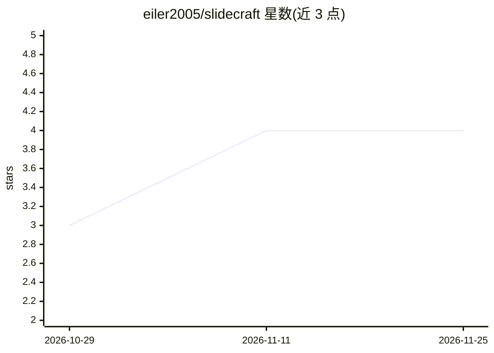

# eiler2005/slidecraft

⭐ 4 · TypeScript · NOASSERTION · 推送 2026-11-14 · [GitHub](https://github.com/eiler2005/slidecraft) · [官网](https://eiler2005.github.io/slidecraft/) · 个人维护

**从一个提示生成可编辑咨询级 PowerPoint 的 CLI 工具**

SlideCraft 是一个零安装 Node CLI，通过用户的 AI 助手（Claude Code、Codex、MCP 接入的 Cursor/Gemini CLI 等）运行：用户给出目标简报，工具按 14 种故事线 × 7 个主题的组合提出模板，生成经批准的动作标题骨架后写入幻灯片，输出可编辑 PPTX、矢量 PDF 与自包含 HTML，并附一页纸与 Word 备忘。数字来自用户的 Excel/CSV 并标注来源页码；构建后执行排版、来源、数字一致性、对比度等自动检查及伙伴式评审。需要能执行代码的助手才能一键完成；内容质量取决于用户提供的数字与来源。

## 筛选速览

| 维度 | 判定 | 备注 |
|---|---|---|
| AI 角色 | `ai-native` | 本体是模型或模型工具 |
| 许可风险 | `none` | NOASSERTION |
| 部署形态 | `library` | 以包/库形式分发 |
| 模型依赖 | — | README 未给出锁定关系 |
| 硬件要求 | — | 无带数字的原话,不猜 |
| 安装摩擦 | `low` | 无编译、无系统依赖或容器化 |
| 成熟度 | — | 结构信号不足 |

## 能力要点

- 四种分层均为纯文本文件（brief.yaml/deck.yaml），可读取与 diff
- 73 种布局契约约束下的动作标题与内容编写，输出场景统一为 Scene IR
- 构建后自动检查：排版不截断、每个数字有来源、同一数字全局一致、对比度、几何
- 14 故事线 × 7 主题独立组合，支持导入 .potx 品牌主题

## 适用场景

- 让 AI 助手根据简报直接生成董事会/客户用的可编辑 PPTX
- 用 Excel/CSV 数据生成带来源标注的执行摘要与战略建议幻灯片
- 导入公司 .potx 品牌主题后按企业视觉规范出片
- 将 Mermaid/draw.io/Excalidraw 图导入为可编辑 PowerPoint 图形

## 场景标签

 · 领域:商业演示/办公工具

## 证据(README 行号)

> L34: **SlideCraft** turns a goal into a consulting-grade presentation. You say what the deck must achieve and for whom. 
> L36: It works with **any AI agent or LLM that can run a command**:

## 星数曲线

2026-10-29 3 → 2026-11-25 4（+1）

---
*卡片 v1 · prompt 1.4 · 生成 2026-11-21 · 置信度 high · 依据 README sha `4427b425e68f` · [字段定义](../../DATASET.md)*
