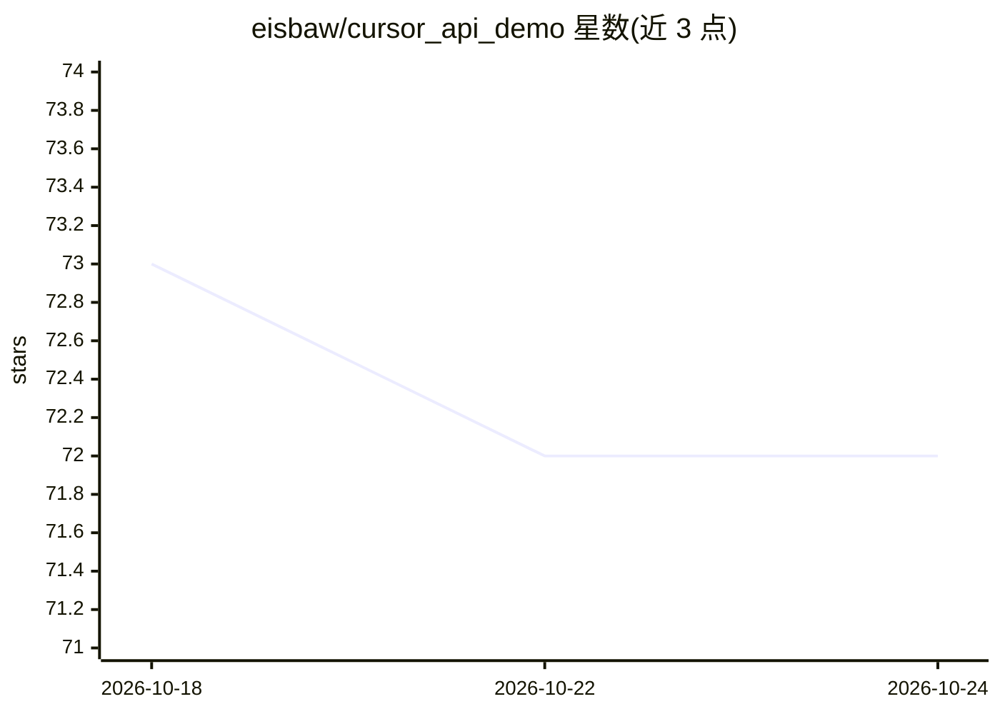

# eisbaw/cursor_api_demo

⭐ 72 · JavaScript · 推送 2026-04-02 · [GitHub](https://github.com/eisbaw/cursor_api_demo) · 个人维护

**逆向 Cursor IDE 2.6.22 后端 API 的 Python 客户端**

针对 Cursor IDE v2.6.22 的 API、认证流程与流式聊天路径的逆向工程工作区：包含 HTTP/2 + ConnectRPC 传输的 Python 客户端、protobuf 请求编码、从 Cursor 本地 SQLite 存储读取 accessToken/refreshToken 并通过 oauth/token 端点刷新。提供 ask CLI 与若干 just 命令做端到端测试与流式演示，另附反编译快照与分析文档。限制：仅实现部分 ClientSideToolV2 处理器，多数 agent 工具为 TODO 占位，双向客户端仍属实验性。

## 筛选速览

| 维度 | 判定 | 备注 |
|---|---|---|
| AI 角色 | `ai-ecosystem` | LLM/agent 周边工具 |
| 许可风险 | `none` | — |
| 部署形态 | `desktop` | 安装包/桌面程序 |
| 模型依赖 | — | README 未给出锁定关系 |
| 硬件要求 | — | 无带数字的原话,不猜 |
| 安装摩擦 | `low` | 无编译、无系统依赖或容器化 |
| 成熟度 | `idea` | |

## 能力要点

- 实现 Cursor 2.6.22 的认证（token 读取与刷新）与流式聊天路径
- HTTP/2 + ConnectRPC 帧 + protobuf 编码的协议实现
- 从本地 state.vscdb 读取 accessToken/refreshToken 并调用刷新端点
- 附带反编译核心快照、分析文档与 FINDINGS.md

## 适用场景

- 研究 Cursor 后端协议与认证机制
- 用 CLI 直接调用 Cursor 聊天/模型列表端点
- 基于逆向发现做协议分析或兼容客户端开发

## 场景标签

 · 领域:开发工具/AI 客户端逆向

## 证据(README 行号)

> L3: Reverse-engineered Python client for Cursor IDE API focused on the `2.6.22`
> L109: - Chat endpoint: `/aiserver.v1.ChatService/StreamUnifiedChatWithTools`

## 星数曲线

2026-10-18 73 → 2026-10-24 72（-1）

---
*卡片 v1 · prompt 1.4 · 生成 2026-10-24 · 置信度 high · 依据 README sha `570b8c14f743` · [字段定义](../../DATASET.md)*
