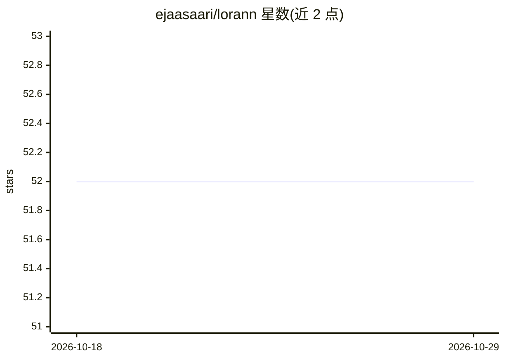

# ejaasaari/lorann

⭐ 52 · C++ · MIT · 推送 2026-10-06 · [GitHub](https://github.com/ejaasaari/lorann) · [官网](http://eliasjaasaari.com/lorann/) · 个人维护

**基于降秩回归的近似最近邻搜索库（NeurIPS'24）**

实现降秩回归（reduced-rank regression，NeurIPS '24）的近似最近邻检索库，面向高维（d>100）现代嵌入数据集，目标为快查询、低内存与快速建索引。以 header-only C++17 库形式提供并附 Python 绑定（pip 安装），针对 AVX2/AVX-512/ARM NEON 做了 SIMD 优化；支持 float32/float16/bfloat16/uint8/binary 数据类型、内积/欧氏/余弦距离、索引序列化。GPU 批量查询为实验性功能，以 Python 子模块形式实现并依赖 PyTorch。

## 筛选速览

| 维度 | 判定 | 备注 |
|---|---|---|
| AI 角色 | `ai-ecosystem` | LLM/agent 周边工具 |
| 许可风险 | `permissive` | MIT |
| 部署形态 | `library` | 以包/库形式分发 |
| 模型依赖 | — | README 未给出锁定关系 |
| 硬件要求 | — | 无带数字的原话,不猜 |
| 安装摩擦 | `high` | 编译与系统依赖俱全 |
| 成熟度 | `idea` | |

## 能力要点

- 降秩回归算法实现 ANN 检索，低内存占用
- header-only C++17 库 + Python 绑定
- AVX2 / AVX-512 / ARM NEON SIMD 优化
- 支持 float16/bfloat16/uint8/binary 量化与索引序列化

## 适用场景

- 在高维嵌入数据集上做低内存的近似最近邻检索
- Python 或 C++ 应用中构建向量索引并批量查询
- 利用 AVX-512/NEON 指令集加速向量搜索

## 场景标签

`向量数据库` · 领域:知识与检索

## 证据(README 行号)

> L3: Approximate nearest neighbor search library implementing reduced-rank regression (NeurIPS '24), a technique enabling
> L12: - Header-only C++17 library with Python bindings
> L14: - Optimized for modern high-dimensional (d > 100) embedding data sets

## 星数曲线

2026-10-18 52 → 2026-10-29 52（+0）

---
*卡片 v1 · prompt 1.4 · 生成 2026-10-24 · 置信度 high · 依据 README sha `c045efbde99a` · [字段定义](../../DATASET.md)*
