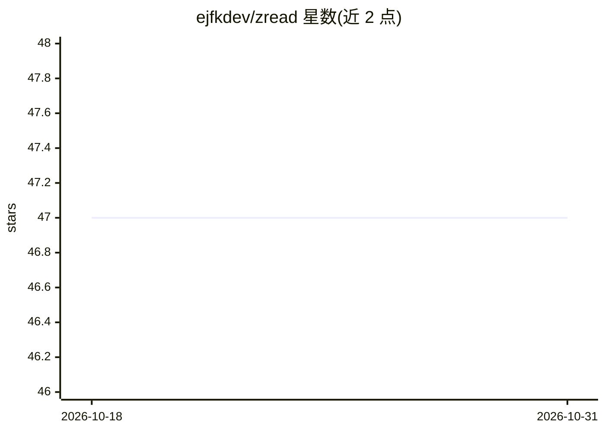

# ejfkdev/zread

⭐ 47 · Python · MIT · 推送 2026-05-24 · [GitHub](https://github.com/ejfkdev/zread) · [官网](https://zread.ai) · 个人维护 · 中文 README

**阅读 GitHub 项目文档的 CLI 与 MCP 服务器工具**

连接 Zread.ai（AI 驱动的 GitHub 项目文档服务）的 Python 命令行工具与 MCP 服务器，面向开发者及其 AI 助手。功能包括浏览/检索仓库文档、查看源码文件、趋势仓库发现、导出文档生成 llms.txt，以及基于文档的 AI 问答（需免费账号 token，可选 glm-5.1 或 claude-sonnet-4.6 模型）。支持 stdio/HTTP/SSE 三种传输，通过 uvx/pipx 一条命令运行，非官方工具。

## 筛选速览

| 维度 | 判定 | 备注 |
|---|---|---|
| AI 角色 | `ai-ecosystem` | LLM/agent 周边工具 |
| 许可风险 | `permissive` | MIT |
| 部署形态 | `library` | 以包/库形式分发 |
| 模型依赖 | — | README 未给出锁定关系 |
| 硬件要求 | — | 无带数字的原话,不猜 |
| 安装摩擦 | `low` | 无编译、无系统依赖或容器化 |
| 成熟度 | — | 结构信号不足 |

## 能力要点

- CLI 与 MCP 服务器双形态，支持 stdio/HTTP/SSE 传输
- 浏览/搜索/导出 GitHub 仓库文档，生成 llms.txt 与 llms-full.txt
- AI 问答支持 glm-5.1 与 claude-sonnet-4.6 模型选择
- 免 token 即可浏览文档、搜索代码与发现仓库

## 适用场景

- 在终端快速查阅 GitHub 项目文档与源码文件
- 为 Claude/Cline 等 AI 助手接入仓库文档检索能力
- 导出项目文档为 llms.txt 供 LLM 使用

## 场景标签

`文档问答` `语义搜索` · 领域:知识与检索

## 证据(README 行号)

> L15: Zread helps you and your AI understand codebases faster. Skip the manual source dive and ask directly. It connects 
> L19: - 🖥️ **CLI tool** - run directly in your terminal with minimal setup
> L20: - 🔌 **MCP server** - integrate with AI assistants such as Claude and Cline

## 星数曲线

2026-10-18 47 → 2026-10-31 47（+0）

---
*卡片 v1 · prompt 1.4 · 生成 2026-10-25 · 置信度 high · 依据 README sha `ef59c35b9199` · [字段定义](../../DATASET.md)*
