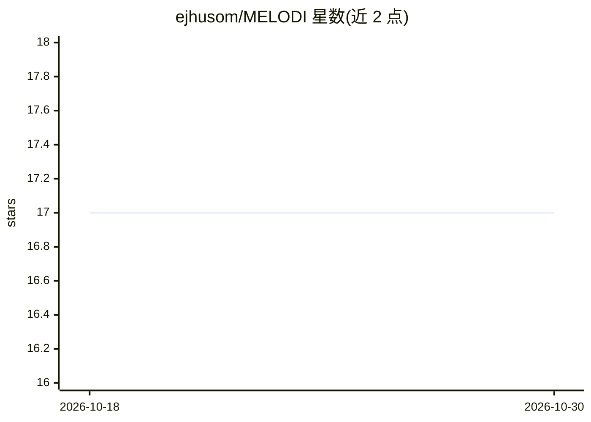

# ejhusom/MELODI

⭐ 17 · Jupyter Notebook · 推送 2026-07-29 · [GitHub](https://github.com/ejhusom/MELODI) · 个人维护

**本地 LLM 推理过程的能耗监测工具，附带能耗数据集**

通过向本地 LLM 服务发送提示词并在推理过程中测量能耗的工具：默认对接 Ollama（mistral 模型），使用 nvidia-smi 与 scaphandre 采集 GPU/系统能耗，需配置无 root 读取 RAPL 文件，并建议将显示服务移至集成显卡以保证 GPU 测量纯净。以 Python 脚本 LLMEC.py 运行，也可编程调用；配置文件可设置 LLM 服务、API URL 与模型名。另在 Hugging Face 发布了多款开源 LLM 的能耗测量数据集。限制：要求推理期间无其他进程占用 GPU。

## 筛选速览

| 维度 | 判定 | 备注 |
|---|---|---|
| AI 角色 | `ai-ecosystem` | LLM/agent 周边工具 |
| 许可风险 | `none` | — |
| 部署形态 | `None` |  |
| 模型依赖 | local-ok | 支持本地模型 |
| 硬件要求 | — | 无带数字的原话,不猜 |
| 安装摩擦 | `low` | 无编译、无系统依赖或容器化 |
| 成熟度 | — | 结构信号不足 |

## 能力要点

- 运行 LLM 提示词的同时测量推理能耗
- 默认对接 Ollama 服务，可通过配置文件更换 LLM 服务与模型
- 使用 nvidia-smi 与 scaphandre 采集能耗数据
- 在 Hugging Face 发布开源 LLM 能耗测量数据集

## 适用场景

- 测量本地 LLM 推理的能耗与功耗
- 对比不同开源 LLM 的能耗表现
- 为绿色 AI / 可持续计算研究采集能耗数据

## 场景标签

 · 领域:LLM 能耗监测/可持续计算

## 证据(README 行号)

> L3: Use local Large Language Models (LLMs) while monitoring energy usage. This project allows you to run prompts on LLMs
> L60: - `llm_service`: The LLM service to use (default: "ollama").

## 星数曲线

2026-10-18 17 → 2026-10-30 17（+0）

---
*卡片 v1 · prompt 1.4 · 生成 2026-10-29 · 置信度 high · 依据 README sha `d1d36be68acb` · [字段定义](../../DATASET.md)*
