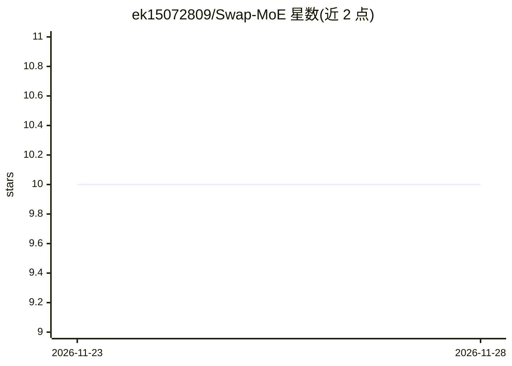

# ek15072809/Swap-MoE

⭐ 10 · C++ · MIT · 推送 2026-10-20 · [GitHub](https://github.com/ek15072809/Swap-MoE) · 个人维护

**低内存 PC 上按需从 SSD 加载 MoE 大模型专家权重的 llama.cpp 补丁**

一组针对 llama.cpp 的补丁文件，将 MoE 模型的路由型专家权重保留在 SSD 上 mmap 映射，由操作系统按需调页仅把路由命中的专家读入 RAM，使文件超过物理内存的大参数 MoE 模型可在消费级 PC 上推理。另提供三个可选机制：LRU keep-recent（每层 RAM 预算上限）、Expert Fixation（固定路由以减少 SSD I/O，README 说明会降低生成质量）、Expert Prefetch（后台线程预测下一步所需专家并预热页缓存）。以单个 patch 文件分发，需应用到指定 commit 的 llama.cpp 并自行编译。

## 筛选速览

| 维度 | 判定 | 备注 |
|---|---|---|
| AI 角色 | `ai-ecosystem` | LLM/agent 周边工具 |
| 许可风险 | `permissive` | MIT |
| 部署形态 | `None` |  |
| 模型依赖 | local-ok | 支持本地模型 |
| 硬件要求 | `cpu-ok` | |
| 安装摩擦 | `medium` | 含编译或系统依赖之一 |
| 成熟度 | — | 结构信号不足 |

## 能力要点

- 专家流式加载：--expert-streaming 单标志启用 mmap 按需调页
- LRU keep-recent 以每层 LRU 列表硬性限制常驻 RAM
- Expert Prefetch 用后台线程预热下一轮前向所需的专家页
- 支持 Qwen3-MoE、MiniMax-M2/M2.7、DeepSeek-V2/V3/V4 等标准 ffn_*_exps 命名的架构

## 适用场景

- 在 16GB 内存的消费级 PC 上无 GPU 运行 200B+ 参数 MoE 模型
- 内存不足以整体加载 GGUF 大模型的场景下推理
- SATA SSD 上解码密集负载时通过预取降低同步页错误停顿

## 场景标签

`推理引擎` · 领域:训练与推理

## 证据(README 行号)

> L31: **Swap-MoE** is a small patch set for llama.cpp
> L35: RAM, on the fly, during inference. Three optional companion mechanisms —
> L215: Swap-MoE is distributed as a single patch file, `llama.cpp-expert-streaming.patch`,

## 星数曲线

2026-11-23 10 → 2026-11-28 10（+0）

---
*卡片 v1 · prompt 1.4 · 生成 2026-11-23 · 置信度 high · 依据 README sha `e1604ad86f15` · [字段定义](../../DATASET.md)*
