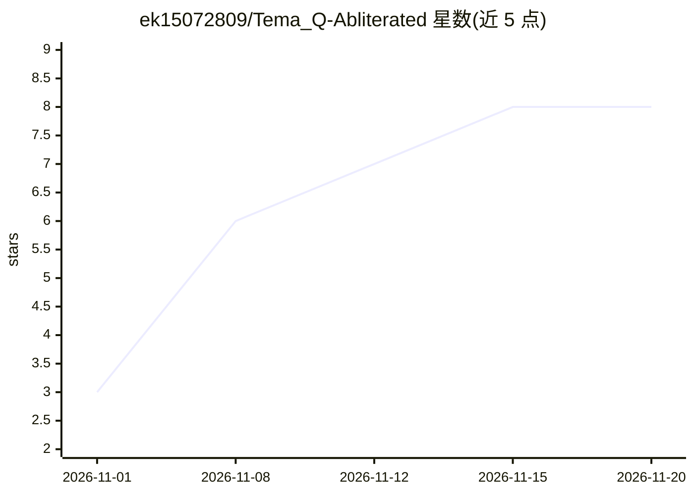

# ek15072809/Tema_Q-Abliterated

⭐ 8 · Python · MIT · 推送 2026-11-04 · [GitHub](https://github.com/ek15072809/Tema_Q-Abliterated) · 个人维护

**LLM 拒绝行为移除的自动化研究工具，CPU 可运行**

Tema_Q-Abliterated 实现名为 SCAPE 的搜索式 abliteration 流程，自动选择 directional ablation 的层级与强度：种子网格初始化、语法下界校准、模式搜索、生成式质量检查与人确认后导出。代理指标替代全文生成使候选评估提速（自述最高约 49×），支持 CPU-only（16 GB RAM）处理 0.5B–9B 模型，并对多方向拒绝模型提供 guard 模式多秩权重重定向。导出 safetensors 或 PEFT LoRA 适配器，可选上传 Hugging Face。声明仅限研究用途。

## 筛选速览

| 维度 | 判定 | 备注 |
|---|---|---|
| AI 角色 | `ai-ecosystem` | LLM/agent 周边工具 |
| 许可风险 | `permissive` | MIT |
| 部署形态 | `library` | 以包/库形式分发 |
| 模型依赖 | — | README 未给出锁定关系 |
| 硬件要求 | `cpu-ok` | |
| 安装摩擦 | `medium` | 含编译或系统依赖之一 |
| 成熟度 | — | 结构信号不足 |

## 能力要点

- 代理指标替代全文生成评估候选（自述最高约 49× 提速）
- CPU-only 路径：16 GB RAM 即可处理 0.5B–9B 模型
- guard 模式：多方向拒绝模型的多秩权重重定向
- 导出 fp32 safetensors 或 PEFT 兼容 LoRA 适配器

## 适用场景

- 对已发布开源模型做 abliteration 研究
- 在无 GPU 的机器上运行模型修改实验
- 只导出小型 LoRA 适配器复现已发布的模型卡参数

## 场景标签

 · 领域:LLM 权重修改/安全研究工具

## 证据(README 行号)

> L25: Tema_Q-Abliterated is a research tool that **automatically finds good settings for directional ablation** (also cal
> L27: Choosing which layers to modify, and how strongly, is the hard part: too strong destroys the model's general abilit

## 星数曲线

2026-11-01 3 → 2026-11-20 8（+5）

---
*卡片 v1 · prompt 1.4 · 生成 2026-11-20 · 置信度 high · 依据 README sha `4e1df277f818` · [字段定义](../../DATASET.md)*
