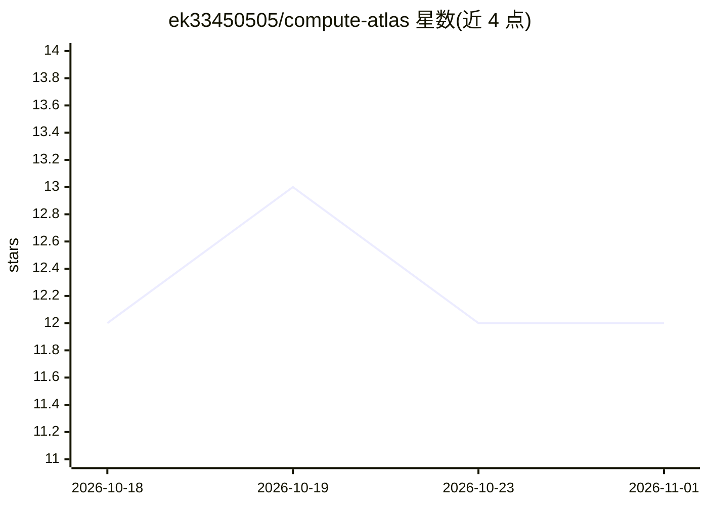

# ek33450505/compute-atlas

⭐ 12 · TypeScript · MIT · 推送 2026-10-31 · [GitHub](https://github.com/ek33450505/compute-atlas) · [官网](https://www.compute-atlas.com) · 个人维护

**全美数据中心/矿场/配套电厂的开源溯源数据集与地图**

覆盖美国数据中心、加密矿场及配套电厂的开源数据集：每条记录含状态、置信度、容量、位置及至少一个带 URL 与检索日期的来源，附交互地图、无鉴权 CORS 开放 API 与可 fork 的 JSON 快照。数据经自动化发现管线产出后必须人工审核发布，禁止派生数字，缺失即'未知'。面向记者、研究者、地方官员与设施周边居民。代码 MIT、数据 CC BY 4.0 双许可，技术栈为 Next.js + Drizzle + Postgres。

## 筛选速览

| 维度 | 判定 | 备注 |
|---|---|---|
| AI 角色 | `ai-knowledge` | 知识聚合/清单类 |
| 许可风险 | `permissive` | MIT |
| 部署形态 | `library` | 以包/库形式分发 |
| 模型依赖 | — | README 未给出锁定关系 |
| 硬件要求 | — | 无带数字的原话,不猜 |
| 安装摩擦 | `low` | 无编译、无系统依赖或容器化 |
| 成熟度 | — | 结构信号不足 |

## 能力要点

- 每条事实携带来源与检索日期（sourceIndex 溯源）
- 公开 CORS 开放 API 与单文件 JSON 批量数据
- 所有候选记录须人工审核，禁止派生数字
- 发现管线用本地 Ollama 模型做来源机械比对

## 适用场景

- 查我所在地区规划建设的数据中心或矿场及其能耗
- 获取全美算力设施的 API/批量数据做分析与报道
- 研究数据中心对能源、水、补贴与社区的影响

## 场景标签

 · 领域:基础设施/开放数据

## 证据(README 行号)

> L20: Compute Atlas is an open, source-cited dataset of **data centers, crypto-mining sites, and
> L25: emissions, and community reception. That information is public, but it is scattered across

## 星数曲线

2026-10-18 12 → 2026-11-01 12（+0）

---
*卡片 v1 · prompt 1.4 · 生成 2026-11-01 · 置信度 high · 依据 README sha `5f1a4809fea2` · [字段定义](../../DATASET.md)*
