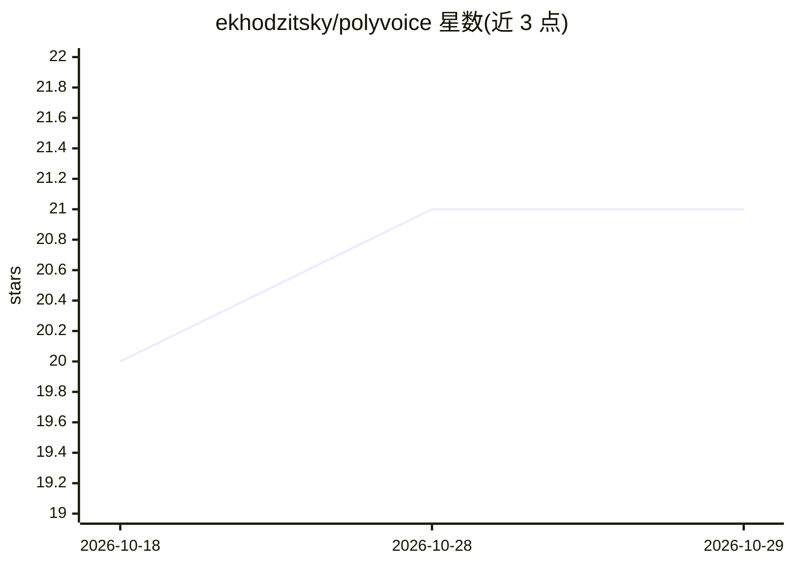

# ekhodzitsky/polyvoice

⭐ 21 · Rust · MIT · 推送 2026-10-10 · [GitHub](https://github.com/ekhodzitsky/polyvoice) · [官网](https://docs.rs/polyvoice) · 个人维护

**Rust 说话人分离库/CLI：CPU 上原生 INT8 内核输出说话人时间戳**

用 Rust 编写的说话人分离（diarization）工具，提供库、CLI、C FFI 和 Python wheel 多种交付面。流水线为：重叠感知的 powerset 神经分割 → WeSpeaker ResNet34 嵌入 → VBx 聚类（AHC/K-means/NME-SC，自动判定说话人数），一次 Pipeline 调用从 16 kHz 单声道音频得到带时间戳的说话人轮次。核心不依赖 ONNX Runtime，使用手写 INT8 内核，神经模型对约 8.4 MB、MIT 许可且无需 token；VBx PLDA 参数为 CC-BY-4.0。仅做批量分离，不做 ASR 或说话人识别。

## 筛选速览

| 维度 | 判定 | 备注 |
|---|---|---|
| AI 角色 | `ai-native` | 本体是模型或模型工具 |
| 许可风险 | `permissive` | MIT |
| 部署形态 | `library` | 以包/库形式分发 |
| 模型依赖 | — | README 未给出锁定关系 |
| 硬件要求 | `cpu-ok` | |
| 安装摩擦 | `low` | 无编译、无系统依赖或容器化 |
| 成熟度 | — | 结构信号不足 |

## 能力要点

- powerset 神经分割 + WeSpeaker ResNet34 + VBx 聚类的完整分离流水线
- 原生 INT8 内核，核心不依赖 ONNX Runtime / PyTorch，CPU-only 运行
- ~8.4 MB 神经模型对，MIT 许可、无需 gated token 访问
- 同一 crate 提供 Rust 库、CLI、C FFI 与 Python wheel

## 适用场景

- 在 Rust 服务中集成会议/录音的说话人分离
- 通过 CLI 把音频转为 RTTM 说话人时间戳
- 无 GPU 或不希望引入 PyTorch 栈的 CPU 部署场景做分离

## 场景标签

`语音识别` · 领域:感知与多模态

## 证据(README 行号)

> L14: A speaker diarization crate. Powerset neural segmentation, WeSpeaker
> L16: `Pipeline` call from 16 kHz mono to timestamped turns. The native product uses
> L104: audio (f32 PCM)

## 星数曲线

2026-10-18 20 → 2026-10-29 21（+1）

---
*卡片 v1 · prompt 1.4 · 生成 2026-10-28 · 置信度 high · 依据 README sha `ffdcd1e88f24` · [字段定义](../../DATASET.md)*
