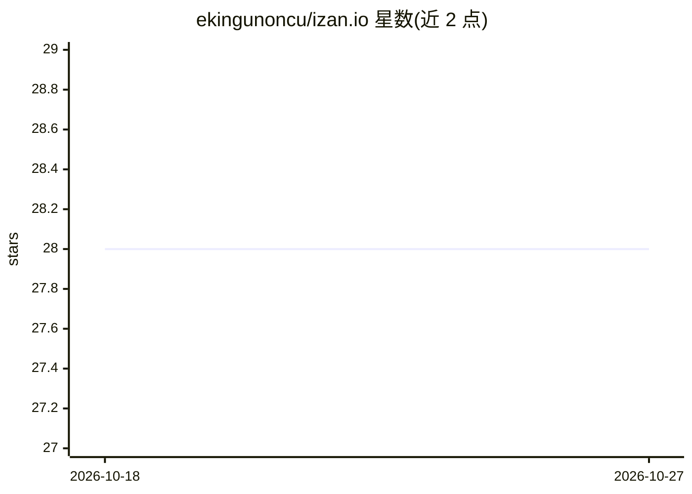

# ekingunoncu/izan.io

⭐ 28 · TypeScript · NOASSERTION · 推送 2026-04-01 · [GitHub](https://github.com/ekingunoncu/izan.io) · [官网](https://izan.io) · 个人维护

**把浏览器变成 MCP 服务器的 Chrome 扩展，供 AI 客户端调用**

Chrome 扩展，将浏览器转变为 MCP 服务器：任何支持 stdio 的 MCP 客户端（Claude Desktop、Cursor、VS Code、Claude Code）可连接并控制浏览器。用户可用 JavaScript 编写工具（通过 browser API 实现点击、输入、导航、数据提取），也可从 zihin.io 社区市场安装工具；扩展运行在用户已认证的浏览器内。内置 web_fetch、accessibility_snapshot 工具。开发方式为 git clone 后 npm install/build，再以未打包扩展形式加载到 Chrome。

## 筛选速览

| 维度 | 判定 | 备注 |
|---|---|---|
| AI 角色 | `ai-ecosystem` | LLM/agent 周边工具 |
| 许可风险 | `none` | NOASSERTION |
| 部署形态 | `library` | 以包/库形式分发 |
| 模型依赖 | — | README 未给出锁定关系 |
| 硬件要求 | — | 无带数字的原话,不猜 |
| 安装摩擦 | `low` | 无编译、无系统依赖或容器化 |
| 成熟度 | — | 结构信号不足 |

## 能力要点

- 将浏览器转变为 MCP 服务器，任何 stdio MCP 客户端可接入
- 用 JavaScript 与 browser API 编写浏览器自动化工具
- 内置 web_fetch、accessibility_snapshot 工具
- 支持从 zihin.io 社区市场安装工具

## 适用场景

- 让 Claude Desktop/Cursor 等 AI 客户端直接操控我的浏览器
- 编写自定义浏览器自动化与数据提取工具供 AI 调用
- 通过市场复用社区共享的浏览器工具

## 场景标签

`浏览器自动化` · 领域:效率与自动化

## 证据(README 行号)

> L21: izan.io is a Chrome extension that turns your browser into an **MCP server**. Any MCP client - Claude Desktop, Curs
> L40: Works with Claude Desktop, Cursor, VS Code, Claude Code, and any MCP client that supports stdio.

## 星数曲线

2026-10-18 28 → 2026-10-27 28（+0）

---
*卡片 v1 · prompt 1.4 · 生成 2026-10-26 · 置信度 high · 依据 README sha `8c6c363eda85` · [字段定义](../../DATASET.md)*
