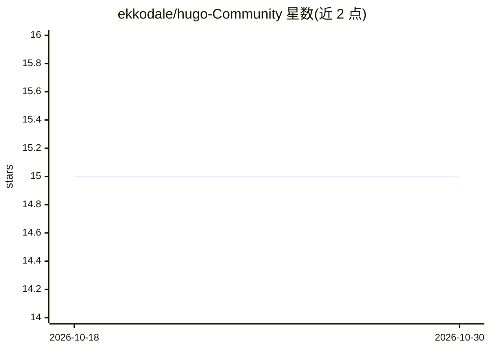

# ekkodale/hugo-Community

⭐ 15 · Apache-2.0 · 推送 2026-01-20 · [GitHub](https://github.com/ekkodale/hugo-Community) · [官网](https://hugo.ekkodale.com/) · 组织维护

**企业本地化 AI 平台：整合 Open WebUI 与 LiteLLM 的私有部署栈**

由 ekkodale GmbH 维护的本地化（on-premise）AI 集成平台，将 Open WebUI 前端与 LiteLLM 网关（支持 100+ AI 提供商）通过 Docker Compose 组合部署，面向关注数据主权的组织。功能包括文档上传与自然语言知识检索（PDF/Word/演示文稿）、LDAP/SSO/AD 认证集成、自定义 AI 管道与 CRM/ERP 等系统对接。提供多档硬件需求表（云端模型 2GB RAM 起步；本地自托管模型需 26GB RAM、12GB 显存、Nvidia Turing+ 与 CUDA），文档含英语与德语版本，另提供企业咨询与支持服务。

## 筛选速览

| 维度 | 判定 | 备注 |
|---|---|---|
| AI 角色 | `ai-ecosystem` | LLM/agent 周边工具 |
| 许可风险 | `permissive` | Apache-2.0 |
| 部署形态 | `self-host` | docker 或自建部署 |
| 模型依赖 | — | README 未给出锁定关系 |
| 硬件要求 | — | 无带数字的原话,不猜 |
| 安装摩擦 | `low` | 无编译、无系统依赖或容器化 |
| 成熟度 | — | 结构信号不足 |

## 能力要点

- Open WebUI + LiteLLM 的 Docker Compose 一体化私有部署
- 支持 100+ AI 提供商的统一网关与模型切换
- LDAP/SSO/Active Directory 认证与自定义 AI 管道集成
- 支持气隙部署选项，架构声明兼容 GDPR 与 HIPAA

## 适用场景

- 在自有基础设施内搭建不外泄数据的组织知识问答系统
- 对建筑规范、技术文档、员工手册等企业资料做语义检索
- 通过统一网关管理多云或本地自托管模型并控制成本与限流

## 场景标签

`模型网关` `RAG` `文档问答` · 领域:Agent 开发

## 证据(README 行号)

> L38: **Open WebUI** - The world's fastest-growing AI platform:
> L47: **LiteLLM** - Universal AI gateway supporting 100+ AI providers:
> L76: Get your enterprise AI stack running in minutes:

## 星数曲线

2026-10-18 15 → 2026-10-30 15（+0）

---
*卡片 v1 · prompt 1.4 · 生成 2026-10-30 · 置信度 high · 依据 README sha `efeeba5a7152` · [字段定义](../../DATASET.md)*
