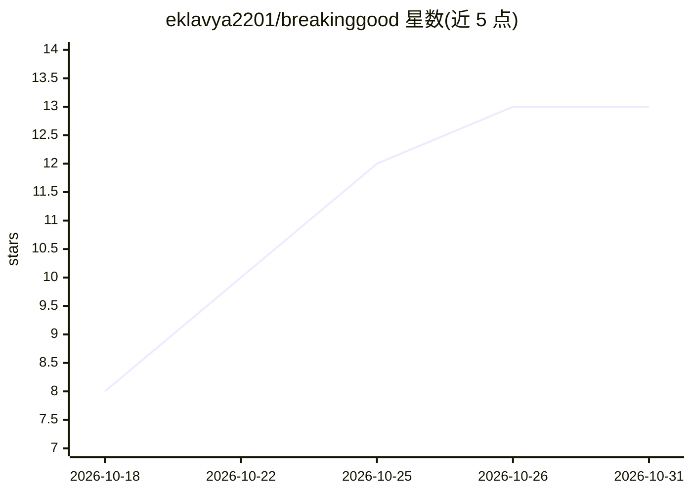

# eklavya2201/breakinggood

⭐ 13 · TypeScript · MIT · 推送 2026-10-24 · [GitHub](https://github.com/eklavya2201/breakinggood) · 个人维护

**一条命令克隆仓库并跑起来，或把网站逆向重建为 React 项目**

面向开发者的 CLI 工具（npx 运行）：给定仓库 URL，浅克隆后自动识别技术栈（Node/Python/Go/Rust 等多种）、读取依赖做安全扫描（安装脚本、可疑来源包、curl|bash 钩子等）、填充 .env 并启动 dev server；给定网站 URL，用本机 Chrome/Edge 无头抓取截图、DOM、计算样式与网络请求，交给模型生成 Vite+React+Tailwind v4 项目和回放 API 的 mock server。支持 Anthropic/OpenAI/Groq/OpenRouter/Gemini/Ollama 多家模型，仓库模式可无模型运行。另可作为 MCP server 供 Claude Code、Cursor 等调用。限制：非沙箱、登录页与 WebGL 页面抓取受限、内容版权需自担。

## 筛选速览

| 维度 | 判定 | 备注 |
|---|---|---|
| AI 角色 | `ai-native` | 本体是模型或模型工具 |
| 许可风险 | `permissive` | MIT |
| 部署形态 | `self-host` | docker 或自建部署 |
| 模型依赖 | local-ok | 支持本地模型 |
| 硬件要求 | — | 无带数字的原话,不猜 |
| 安装摩擦 | `low` | 无编译、无系统依赖或容器化 |
| 成熟度 | — | 结构信号不足 |

## 能力要点

- 仓库模式：自动识别 10 余种技术栈并安装、启动、打开浏览器
- 依赖安全扫描：安装脚本、非公开注册表来源、90 天内新发布依赖、混淆代码等检查
- 网站模式：抓取截图/DOM/计算样式/XHR 后生成 Vite+React+Tailwind 项目与 API mock server
- 可作为 MCP server 提供 capture_site/scan_repo/clone_and_prepare 工具

## 适用场景

- 快速把陌生开源仓库在本地跑起来，先看安全扫描结果
- 研究喜欢的落地页是怎么实现的，得到可运行的前端项目
- 在 Claude Code/Cursor 等 agent 中调用网站抓取与仓库扫描能力

## 场景标签

`代码生成` `网页抓取` `网络安全` · 领域:效率与自动化

## 证据(README 行号)

> L64: 3. Hand all of that to the model and ask for a Vite + React + Tailwind v4
> L75: Site mode needs a model. Repo mode works without one; it just gets smarter with

## 星数曲线

2026-10-18 8 → 2026-10-31 13（+5）

---
*卡片 v1 · prompt 1.4 · 生成 2026-10-31 · 置信度 mid · 依据 README sha `bbe469b0ecd2` · [字段定义](../../DATASET.md)*
