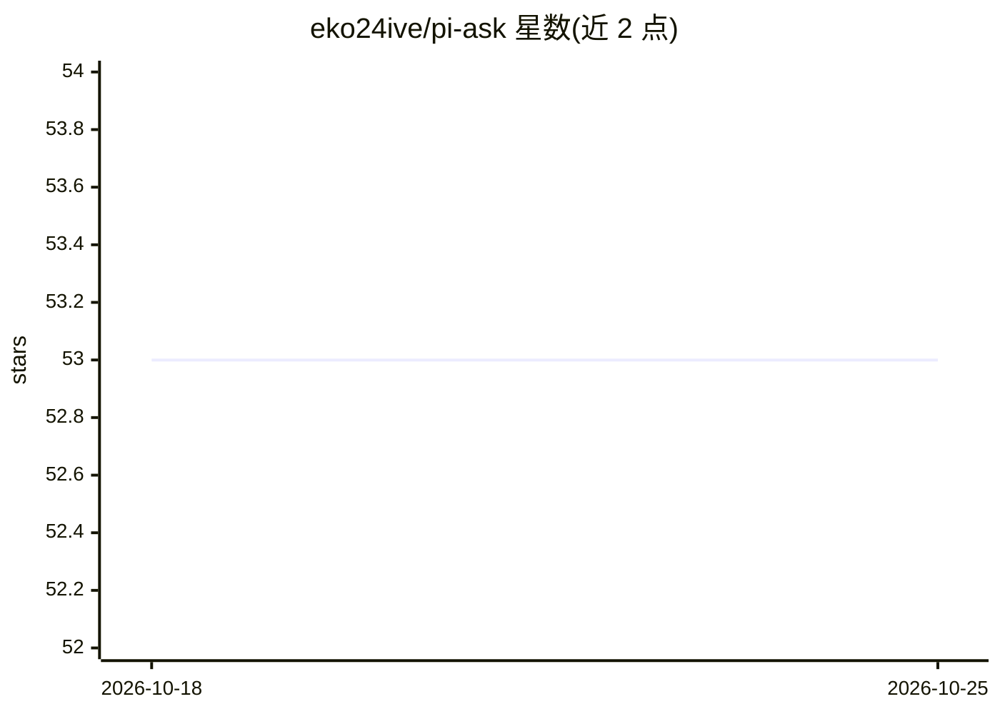

# eko24ive/pi-ask

⭐ 53 · TypeScript · MIT · 推送 2026-08-16 · [GitHub](https://github.com/eko24ive/pi-ask) · [官网](https://www.npmjs.com/package/@eko24ive/pi-ask) · 个人维护

**Pi 编码代理的澄清提问扩展：终端 UI 中提问并回传规范化答案**

面向 Pi coding agent 的扩展包，注册 ask_user 工具与 /answer、/ask:replay 等命令：代理可暂停并弹出终端结构化问答界面（单选/多选、自由输入、@ 文件引用、选项/问题级备注、Review 标签页），提交后以规范化答案返回代理，替代猜测。回答流程按会话分支持久化，支持中断后自动恢复与重放；键位、通知与行为可通过配置文件自定义。通过 pi install 命令安装。

## 筛选速览

| 维度 | 判定 | 备注 |
|---|---|---|
| AI 角色 | `ai-ecosystem` | LLM/agent 周边工具 |
| 许可风险 | `permissive` | MIT |
| 部署形态 | `library` | 以包/库形式分发 |
| 模型依赖 | — | README 未给出锁定关系 |
| 硬件要求 | — | 无带数字的原话,不猜 |
| 安装摩擦 | `low` | 无编译、无系统依赖或容器化 |
| 成熟度 | — | 结构信号不足 |

## 能力要点

- 注册 ask_user 工具，代理以终端 UI 结构化提问并获取规范化答案
- 支持单选/多选、自由输入、@ 文件引用、选项与问题级备注
- 分支感知的 /answer、/answer:again、/ask:replay 重放命令
- 中断会话的未答表单自动恢复一次

## 适用场景

- 让编码代理在不确定时向我提问而不是猜测
- 对代理用纯文本提出的问题补做结构化回答
- 会话恢复或分支切换后重开未完成的问答表单

## 场景标签

`编码 Agent` · 领域:编码与开发

## 证据(README 行号)

> L12: `@eko24ive/pi-ask` is an ask tool that cares about your answers.
> L146: After installation, the extension registers the `ask_user` tool plus `/ask-settings`, `/answer`, `/answer:again`, 

## 星数曲线

2026-10-18 53 → 2026-10-25 53（+0）

---
*卡片 v1 · prompt 1.4 · 生成 2026-10-24 · 置信度 mid · 依据 README sha `629843c1d447` · [字段定义](../../DATASET.md)*
