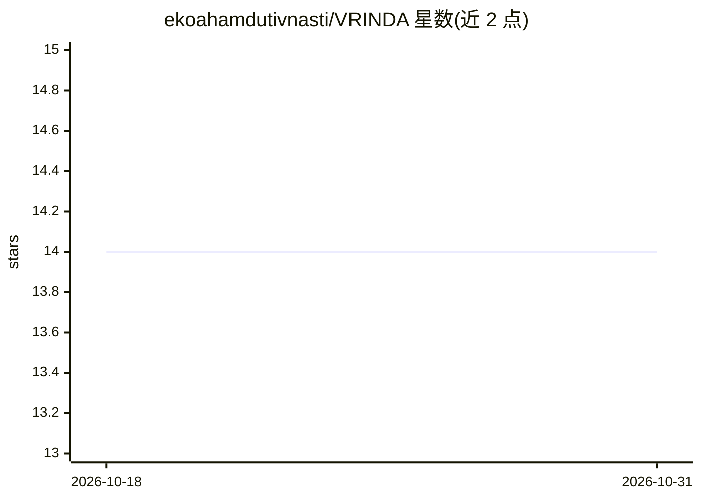

# ekoahamdutivnasti/VRINDA

⭐ 14 · Python · Apache-2.0 · 推送 2025-11-25 · [GitHub](https://github.com/ekoahamdutivnasti/VRINDA) · [官网](https://ekoahamdutivnasti.online/vrinda/) · 个人维护

**宣称的印度自研 AI 助手项目，仓库仅含占位文件与介绍文档**

Vrinda AI 自称是基于 Python 的 AI 助手，宣称具备多模态处理（文本/图像/文件）、网络搜索、图像生成（Divya Diffusion / Juggernaut XL）与双模式（Normal/Hacker）对话能力，由个人开发者 Navneet Singh 维护。但 README 明确声明：仓库内所有文件均为占位符，实际的 AI 系统、RTMS 安全技术与编排框架不公开，仓库仅作参考与文档空间。贡献仅限受邀成员，公开占位文件采用 Apache 2.0 许可，实际系统为专有许可。无可用安装或运行方式。

## 筛选速览

| 维度 | 判定 | 备注 |
|---|---|---|
| AI 角色 | `ai-native` | 本体是模型或模型工具 |
| 许可风险 | `permissive` | Apache-2.0 |
| 部署形态 | `None` |  |
| 模型依赖 | — | README 未给出锁定关系 |
| 硬件要求 | — | 无带数字的原话,不猜 |
| 安装摩擦 | `low` | 无编译、无系统依赖或容器化 |
| 成熟度 | — | 结构信号不足 |

## 能力要点

- 宣称多模态处理：文本、图像与文件
- 宣称双模式设计（Normal Mode / Hacker Mode）
- 宣称多模型编排框架与 RTMS 实时监控系统
- 仓库仅含占位文件，实际系统不公开

## 适用场景

- 了解该项目宣称的 AI 助手能力与架构
- 访问其官网试用在线服务
- 作为文档占位仓库参考

## 场景标签

`AI 助手` · 领域:对话与助手

## 证据(README 行号)

> L26: - **Multimodal Processing** - Handle text, images, and files with ease
> L88: **IMPORTANT:** All files in this repository are **placeholders only**. The actual Vrinda AI system, including the p

## 星数曲线

2026-10-18 14 → 2026-10-31 14（+0）

---
*卡片 v1 · prompt 1.4 · 生成 2026-10-31 · 置信度 mid · 依据 README sha `95ec4c7ded6e` · [字段定义](../../DATASET.md)*
