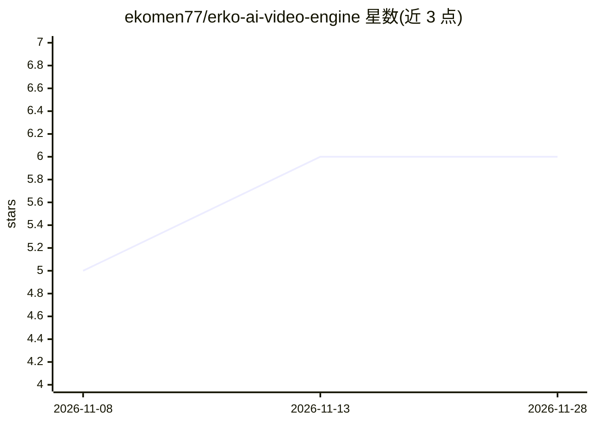

# ekomen77/erko-ai-video-engine

⭐ 6 · JavaScript · MIT · 推送 2026-11-04 · [GitHub](https://github.com/ekomen77/erko-ai-video-engine) · 个人维护

**将语音旁白渲染为 ekomen77 风格 1080p 讲解视频的引擎**

以程序化 Canvas + headless Chrome + FFmpeg 管线，将用户的语音录音渲染为 ekomen77 风格的 1080p 讲解视频：本地 HTTP 服务器驱动 Chrome 逐帧渲染并直接送入 FFmpeg，音频经 48 kHz 归一化与程序化 SFX 混音后按 30 fps RMS 包络同步。既可作为 agent skill（opencode/Claude 等编码 agent）安装，也可作为 CLI 手动运行；附 20 条渲染黄金规则、13 个角色姿势、19 个字体文件与两个生产模板。运行需 Node 18+、FFmpeg、Chrome/Chromium 与 Python 3.8+（numpy 可选）。

## 筛选速览

| 维度 | 判定 | 备注 |
|---|---|---|
| AI 角色 | `ai-native` | 本体是模型或模型工具 |
| 许可风险 | `permissive` | MIT |
| 部署形态 | `library` | 以包/库形式分发 |
| 模型依赖 | — | README 未给出锁定关系 |
| 硬件要求 | — | 无带数字的原话,不猜 |
| 安装摩擦 | `medium` | 含编译或系统依赖之一 |
| 成熟度 | — | 结构信号不足 |

## 能力要点

- headless Chrome 逐帧渲染直通 FFmpeg，磁盘不落中间帧，960 帧演示约 65 秒渲染完成
- SKILL.md 含 20 条从真实渲染迭代提炼的黄金规则与反模式清单
- 两条音频线：numpy SFX 混音器与纯标准库立体声混音器，均输出 30 fps RMS 包络
- 单命令换声：替换语音后 30 秒内完成重新混音与渲染

## 适用场景

- 把录好的解说语音渲染成白板讲解风格视频
- 让编码 agent 依据 SKILL.md 全流程产出视频
- 为已有章节批量替换旁白并重新渲染合成全片

## 场景标签

`视频生成` · 领域:内容生成

## 证据(README 行号)

> L9: **Ses kaydınızı ekomen77 tarzı 1080p anlatım videosuna dönüştürün.** Stüdyo beyaz tahtaları, tebeşir kâğıt diyagraml
> L11: **Ajan becerisi (skill)** olarak (opencode / Claude / herhangi bir kodlama ajanı) ya da düz CLI hattı olarak çalışı
> L50: Gereksinimler: **Node 18+**, `PATH`'te **FFmpeg**, **Chrome/Chromium** (otomatik bulunur), **Python 3.8+** (numpy y

## 星数曲线

2026-11-08 5 → 2026-11-28 6（+1）

---
*卡片 v1 · prompt 1.4 · 生成 2026-11-20 · 置信度 high · 依据 README sha `92acaf9685ff` · [字段定义](../../DATASET.md)*
